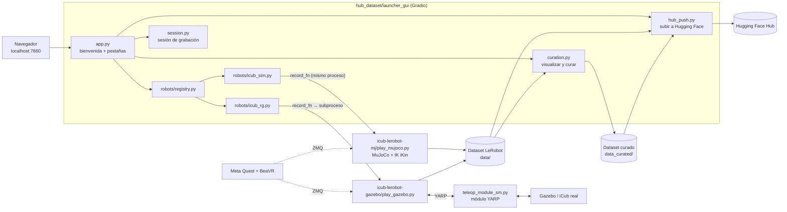

# Experimentation Hub

[English](README.md) | **Español**

Plataforma web para **grabar, revisar, curar y publicar datasets de robótica** en formato
[LeRobot](https://github.com/huggingface/lerobot). Pensada para **cualquier robot**:
la grabación, la revisión de episodios, la curación y la subida a Hugging Face son comunes,
y cada robot se integra como un *backend* independiente
(ver [Cómo agregar un robot](#cómo-agregar-un-robot)).

Actualmente cuenta con un robot integrado, el **iCub**, en tres plataformas: la simulación en **MuJoCo**,
la simulación en **Gazebo** y el **iCub real**. Las tres se teleoperan con lentes de
realidad virtual (Meta Quest 2), con la aplicación **BeaVR** modificada.

- [Plataformas disponibles](#plataformas-disponibles)
- [Instalación y arranque](#instalación-y-arranque)
- [Cómo se usa](#cómo-se-usa)
- [Arquitectura](#arquitectura)
- [Cómo agregar un robot](#cómo-agregar-un-robot)
- [Datos que se graban](#datos-que-se-graban)
- [Estructura del repositorio](#estructura-del-repositorio)
- [Documentación relacionada](#documentación-relacionada)

---

## Plataformas disponibles

| Plataforma (bienvenida) | Backend | Cómo corre | Tareas |
|---|---|---|---|
| **iCub Simulated MJ** | `robots/icub_sim.py` | Dentro del proceso del Hub (MuJoCo 3.3) | Block Lifting, Block Stacking, Pick-and-Place, Door Opening, Two-Arm Peg-In-Hole, Two-Arm Lifting |
| **iCub Real / Gazebo** | `robots/icub_rg.py` | Subproceso aparte, conectado al robot por YARP | Block Lifting, Block Stacking, Pick-and-Place, Door Opening, Two-Arm Peg-In-Hole, Two-Arm Lifting  |

- Las tareas se declaran una sola vez en
  `icub-lerobot-mj/dependencies/assets/scenes/scenes.yaml`, y Gazebo usa el mismo archivo.
- Los dos backends graban **el mismo dataset**: mismas variables, en el mismo frame y con
  las mismas cámaras. Así un dataset de una plataforma sirve para la otra (ver
  [Datos que se graban](#datos-que-se-graban)).

**Teleoperación:** con la app BeaVR en un Meta Quest (por Wi-Fi o cable USB) o **interactivamente con el ratón y teclado en el visor de MuJoCo**.

#### Controles con VR (Meta Quest)

| Control VR | Acción |
|---|---|
| Gatillo inferior (grip) | Cierre de la pinza, gradual: 0 = abierta, 1 = cerrada |
| Gatillo índice | Congela brazos y cabeza (para reacomodarse) |
| **A** | Iniciar episodio |
| **B** | Detener y guardar episodio (mantener **B**: descartarlo) |
| **Y** | Reposicionar los objetos de la escena |

#### Teleoperación Bímana en MuJoCo con Mocaps (Ratón y Teclado)

Para teleoperar interactivamente en MuJoCo sin visor VR, se manipulan directamente los cuerpos *mocap* (`r_hand_target`, `l_hand_target`, `head_target`) en la interfaz gráfica:

```bash
# 1. Con Cinemática Inversa QP (TSIK - iCubWholeBodyIK):
pixi run python play.py --backend mujoco --controller ik --control-arms both --no-record

# 2. Con Dinámica Inversa QP (TSID - iCubWholeBodyID):
pixi run python play.py --backend mujoco --controller id --control-arms both --no-record

# 3. Con TSID + Modo de Impedancia Cartesiana compliant:
pixi run python play.py --backend mujoco --controller id --impedance --control-arms both --no-record
```

**Interacción en el visor gráfico de MuJoCo:**
- **Seleccionar un efector:** Haz **doble clic izquierdo** sobre el mocap deseado (`r_hand_target` o `l_hand_target`).
- **Mover posición ($X, Y, Z$):** Mantén presionada la tecla `Ctrl` y **arrastra con Clic Derecho**.
- **Rotar orientación ($SO(3)$):** Mantén presionada la tecla `Ctrl` y **arrastra con Clic Izquierdo**.
- **Control de pinzas / manos:**
  - Mano derecha: tecla `8` (abrir) / tecla `9` (cerrar).
  - Mano izquierda: tecla `6` (abrir) / tecla `7` (cerrar).
- **Control de simulación y postura:**
  - `ESPACIO`: Resetea los mocaps al origen y mueve el robot suavemente a la postura de inicio (*home*).
  - `T`: Pausa o activa el seguimiento teleoperado.
  - `N`: Resetea la posición de los objetos en la mesa.
  - `I`: Alterna en caliente el modo de impedancia cartesiana (cuando se usa `--controller id`).
- **Comandos de consola (`play.py`):**
  - `1`: Iniciar grabación de episodio.
  - `2`: Detener y guardar episodio.
  - `h`: Solicitar retorno suave a postura inicial (*home*).
  - `3`: Salir de la teleoperación.

---

## Instalación y arranque

### Con Pixi (Recomendado para desarrollo local)

El proyecto está completamente integrado con [Pixi](https://pixi.sh), lo que permite gestionar dependencias de robótica (MuJoCo, YARP, BLF, LeRobot, PyTorch con CUDA) de forma automática y reproducible:

```bash
# 1. Instalar dependencias del entorno
pixi install

# 2. Levantar el Experimentation Hub (Web GUI)
pixi run hub            # http://localhost:7860

# 3. O ejecutar directamente el launcher unificado por terminal
pixi run play-mj        # Teleoperación MuJoCo (BLF TSIK)
pixi run play-gz        # Teleoperación Gazebo Sim
```

### Con Docker

Una sola imagen trae el Hub, MuJoCo, Gazebo y el cliente YARP del robot real. Requiere
Linux con X11, una GPU NVIDIA con NVIDIA Container Toolkit y unos 25 GB libres.

```bash
docker compose build                  # la primera vez; después solo si cambia el código
xhost +SI:localuser:$(id -un)         # permite al contenedor abrir ventanas
docker compose up                     # levanta el Hub
```

Luego se abre <http://localhost:7860>. Los datasets quedan en `./data` y
`./data_curated` del host. Detalles (volúmenes, robot real, puertos del VR, cómo
actualizar el entorno) en [docker/README.md](docker/README.md).

### Sin Docker (Conda legacy)

El entorno es `icubenv`, con Python 3.12, YARP 3.12, gz-sim 10, MuJoCo 3.3, torch 2.7 y
LeRobot v0.5.0+18:

```bash
conda create -n icubenv --file docker/conda-linux-64.lock
conda activate icubenv
pip install --no-deps --ignore-installed -r docker/requirements.lock.txt
pip install --no-deps "lerobot @ git+https://github.com/huggingface/lerobot.git@017ff73fbfe46bf9a673cd9b402988dcb79151f7"
pixi run hub
```

El controlboard parchado de Gazebo (`icub-lerobot-gazebo/gazebo/plugins/*.so`) ya viene
compilado para este entorno. Si no carga, se recompila con
`bash icub-lerobot-gazebo/gazebo/plugins/build_controlboard.sh`.

---

## Cómo se usa

El Hub sigue el orden de sus pestañas, que están numeradas.

**Bienvenida.** Se elige la plataforma: *iCub Simulated MJ* o *iCub Real / Gazebo*.

**1. Configuration**

- *1. Session settings*. Se configuran:
  - la tarea y el `Repo ID` (nombre del dataset);
  - el número de episodios, los FPS y la duración máxima de cada episodio (0 = sin límite);
  - la carpeta donde se guarda el dataset y los brazos que se controlan;
  - el VR: por cable USB o por IP del Quest.
- *Solo Gazebo / real*: *2. Robot stack*. Se levanta en orden:
  1. la simulación de Gazebo (o la conexión al robot real);
  2. el módulo YARP.
- **Lanzar la sesión**: *LAUNCH SESSION* en MuJoCo o *LAUNCH TELEOP / RECORDING* en Gazebo/real.

**2. Episode Control**

- Estado y progreso de la sesión (episodios guardados de los planificados).
- Botones *RECORD episode*, *STOP episode* y *End session*. Hacen lo mismo que A y B en el VR.
- *Logbook*: notas sobre el episodio en curso, guardadas con su número.
- Métricas en vivo (FPS, latencia, tamaño del dataset) y métricas por episodio.
- Log en vivo. El log completo queda en `hub_dataset/logs/`.

**3. Visualize & Curate**

1. *Dataset*: elegir, cargar o borrar un dataset. El borrado lo manda a la papelera del sistema.
2. *Episodes*: recorrer los episodios con sus tres cámaras sincronizadas y marcar los que
   se excluyen del dataset final.
3. *Signal plots*: graficar cualquier dimensión de `action` u `observation.state` sobre el
   video. Los gráficos se exportan a HTML o PDF.
4. *Signals to include*: quitar features completas o dimensiones sueltas.
5. *Language instruction*: editar la instrucción de la tarea para todo el dataset.
6. *Packaging*: genera el dataset curado en `data_curated/`. El original no se modifica.
7. *Upload to Hugging Face Hub*: sube el dataset empaquetado si lo hay y, si no, el
   original tal como se grabó.
   - La línea *Will upload* indica cuál de los dos se va a subir.
   - Si hay cambios de curación sin empaquetar, la subida se bloquea.
   - Solo se suben `data/`, `meta/` y `videos/`.

Cada dataset queda en `data/<repo_id>_<fecha>/` y trae la subcarpeta `hub_session/`, con:

- `episode_metrics.json/.csv/.png`: FPS, latencia, duración y tamaño de cada episodio;
- `logbook.json/.txt`: las notas de la bitácora.

---

## Arquitectura



### Módulos del Hub (`hub_dataset/launcher_gui/`)

| Módulo | Qué hace |
|---|---|
| `app.py` | Arma la interfaz (bienvenida, pestañas, CSS) y conecta cada componente con su lógica |
| `robots/base.py`, `robots/registry.py` | Contrato de un backend y lista de backends disponibles |
| `robots/icub_sim.py`, `robots/icub_rg.py` | Formulario y lanzamiento de cada plataforma |
| `session.py` | Thread de la sesión, cola de comandos, estado, log y poller de *Episode Control* |
| `session_log.py` | Métricas por episodio y bitácora (`hub_session/` del dataset) |
| `curation.py` | Carga de datasets, navegación de episodios, gráficos, borrado y empaquetado |
| `hub_push.py` | Subida a Hugging Face Hub |
| `video_sync.py` | Reproductor de las tres cámaras sincronizado con los gráficos |
| `procman.py` | Procesos externos de larga vida (p. ej. el módulo YARP) y scripts (`start_sim.sh`) |
| `ports.py` | Revisa y libera los puertos del VR antes de lanzar una sesión |
| `state.py` | Estado compartido entre módulos |
| `ui/` | Construcción de cada pestaña, selector de carpetas y filtros de los campos numéricos |

Solo puede haber **una sesión de grabación activa a la vez**.

---

## Cómo agregar un robot

No hace falta tocar las pestañas comunes. Basta con un archivo nuevo en `robots/` y una
línea en el registro.

**1. Crear `hub_dataset/launcher_gui/robots/mi_robot.py`:**

```python
from datetime import datetime
from pathlib import Path

import gradio as gr

from .. import session
from ..paths import ASSETS_DIR, HUB_ROOT
from .base import RobotBackend


def build_config_form() -> dict[str, gr.components.Component]:
    """Componentes de la pestaña Configuration (ya dentro de un gr.Column)."""
    gr.Markdown("### 1. Session settings")
    repo_id = gr.Textbox(value="local/mi_robot_demo", label="Repo ID")
    num_eps = gr.Number(value=50, label="Number of episodes", precision=0, minimum=1)
    gr.Markdown("### 2. Launch session")
    launch_btn = gr.Button("LAUNCH SESSION", variant="primary", size="lg")
    launch_status = gr.Textbox(label="Launch status", interactive=False)
    # num_eps, launch_btn y launch_status son obligatorios: app.py los usa por nombre
    return dict(repo_id=repo_id, num_eps=num_eps,
                launch_btn=launch_btn, launch_status=launch_status)


def launch(repo_id, num_eps) -> str:
    """Recibe los valores del formulario en el orden de config_input_order."""
    if session.state.running:
        return "A session is already running."
    rid = repo_id.strip() if "/" in repo_id else f"local/{repo_id.strip()}"
    stamp = datetime.now().strftime("%Y-%m-%d_%H-%M-%S")
    dataset_root = HUB_ROOT.parent / "data" / f"{rid.replace('/', '_')}_{stamp}"

    def record_fn(cmd_source, on_status):
        # Conectar el robot, crear el LeRobotDataset en dataset_root y, en un bucle:
        #   cmd = cmd_source()   -> "1" iniciar, "2" guardar, "3" salir, None
        #   on_status("waiting") / on_status("recording") / on_status(f"saved:{n}")
        #   on_status({"metrics": {"fps": ..., "latency_ms": ..., "size_mb": ...}})
        ...

    return session.start_session(record_fn, repo_id=rid, dataset_root=dataset_root,
                                 num_episodes=int(num_eps))


BACKEND = RobotBackend(
    id="mi_robot",
    label="Mi Robot",                       # texto del botón en la bienvenida
    image=ASSETS_DIR / "mi_robot.png",      # imagen del botón
    available=True,                         # False: el botón solo avisa "not yet available"
    build_config_form=build_config_form,
    launch=launch,
    config_input_order=["repo_id", "num_eps"],  # claves del formulario, en el orden de launch()
)
```

**2. Registrarlo** en [robots/registry.py](hub_dataset/launcher_gui/robots/registry.py):

```python
from . import icub_rg, icub_sim, mi_robot

REGISTRY = [icub_sim.BACKEND, icub_rg.BACKEND, mi_robot.BACKEND]
```

**3. Agregar su imagen** a `hub_dataset/assets/` y, si su código vive en un proyecto
hermano (como `icub-lerobot-mj/`), su ruta en
[paths.py](hub_dataset/launcher_gui/paths.py).

Con eso la plataforma aparece en la bienvenida, tiene su formulario en *Configuration*,
y *Episode Control*, *Visualize & Curate* y la subida funcionan sin cambios.

**Recomendaciones:**

- **Elegir el patrón de ejecución.**
  - Si las dependencias del robot pueden convivir con las del Hub, `record_fn` puede
    correr en el mismo proceso (como `icub_sim`).
  - Si no, conviene un subproceso con un puente de entrada/salida, como `_bridge_play`
    en `icub_rg.py`.
- **Procesos auxiliares de larga vida** (drivers, servidores): lanzarlos con `procman.py`,
  así su salida aparece en el log del Hub.
- **Datasets intercambiables con los del iCub:** usar los mismos nombres de variables,
  frames y cámaras (ver [Datos que se graban](#datos-que-se-graban)).
- **Docker:** si el robot necesita paquetes nuevos, instalarlos en `icubenv`, regenerar
  los lockfiles con `docker/freeze_env.sh` y reconstruir la imagen.

---

## Datos que se graban

Los dos backends del iCub graban las mismas variables, así que un dataset de MuJoCo y uno
de Gazebo son intercambiables:

- **Acción.** Pose objetivo de cada mano: posición y cuaternión, en el frame *root* del
  iCub. Además, el cierre de la pinza (de 0 a 1) y el punto de mirada.
- **Estado.**
  - articulaciones: posición, velocidad y torque;
  - pose del efector final y último comando enviado (pose objetivo, pinza y mirada);
  - tacto en pulgar, índice y medio;
  - pose de los objetos de la escena: es *ground truth* del simulador y no existe en el
    robot real.
- **Cámaras.** `left` y `right` son los ojos del iCub; `front` es una cámara externa.
  Todas graban a 320×240.
- **Solo se graba el brazo elegido** en *Control arms*.
- **Cuaterniones con signo fijo.** Mano con `quat_y ≤ 0` y objetos con `quat_w ≥ 0`, en
  ambos simuladores. Así no hay saltos entre `q` y `−q`.
- **Diferencia entre plataformas.** Gazebo y el robot real graban también los ojos
  (`eyes_*`), que MuJoCo no modela.

El contrato completo, con las diferencias que quedan entre simuladores, está en la
sección *Sim-to-sim* de [icub-lerobot-gazebo/README.md](icub-lerobot-gazebo/README.md).

---

## Estructura del repositorio

```
PMM_Final/
├── pixi.toml                    # Configuración del entorno de dependencias y tareas Pixi
├── pixi.lock                    # Lockfile de dependencias reproducible
├── play.py                      # Launcher unificado de teleoperación y grabación (MuJoCo, Gazebo, Real)
├── eval_policy.py               # Evaluador unificado de políticas entrenadas
├── train_policy.py              # Wrapper de entrenamiento LeRobot
├── replay_mujoco.py             # Reproducción de datasets grabados en MuJoCo
├── config/
│   └── control_config.yaml      # Configuración central de control, solvers BLF y parámetros de teleoperación
├── src/                         # Código fuente unificado
│   ├── controllers/             # Solvers de optimización cuadrática de cuerpo completo (BLF TSIK y TSID)
│   ├── interfaces/              # Módulo YARP (teleop_module_sm.py), BLFRobotBridge, teleop MuJoCo y VR
│   ├── plugins/                 # Plugins de LeRobot (icub_mujoco, icub_remote, icubteleop)
│   ├── hub_dataset/             # Experimentation Hub (Web GUI Gradio, sesión, curación, subida a HF)
│   ├── trajectories/            # Rutinas de trayectorias analíticas
│   └── tools/                   # Curación de cuaterniones (canonicalize_quats.py), offsets, etc.
├── mujoco_sim/                  # Activos de simulación MuJoCo (escenas XML, mallas OBJ, texturas)
├── gazebo_sim/                  # Activos de simulación Gazebo (mundos SDF, modelos, plugins, scripts)
├── metrics/                     # Latencia, jitter y reportes de teleoperación
├── docker/                      # Dockerfile y docker-compose.yml alternativo
├── data/                        # Datasets grabados (no versionado)
└── data_curated/                # Datasets curados (no versionado)
```

---

## Documentación relacionada

| Documento | Contenido |
|---|---|
| [docker/README.md](docker/README.md) | Imagen Docker: requisitos, volúmenes, robot real, puertos del VR, actualizar el entorno |
| [icub-lerobot-gazebo/README.md](icub-lerobot-gazebo/README.md) | Stack Gazebo / robot real (YARP), configuración y contrato *sim-to-sim* de los datos |
| [icub-lerobot-gazebo/gazebo/README.md](icub-lerobot-gazebo/gazebo/README.md) | Scripts para levantar y detener la simulación de Gazebo |
| [icub-lerobot-mj/lerobot-robot-icub/README.md](icub-lerobot-mj/lerobot-robot-icub/README.md) | Plugin LeRobot del iCub en MuJoCo |
| [metrics/README.md](metrics/README.md) | Cómo medir latencia, jitter y sincronización de las grabaciones |
