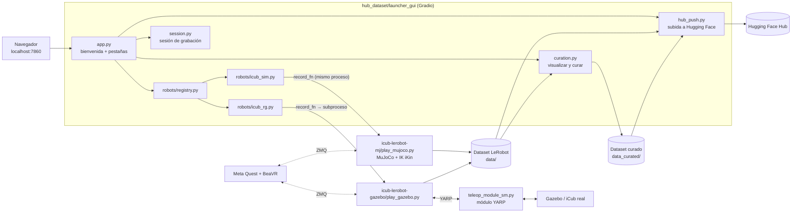

# Experimentation Hub

[English](README.md) | **Español**

Plataforma web para **grabar, revisar, curar y publicar datasets de robótica** en formato
[LeRobot](https://github.com/huggingface/lerobot). Está pensada para **cualquier robot**:
la grabación, la revisión de episodios, la curación y la subida a Hugging Face son
compartidas, y cada robot se conecta como un *backend* independiente
(ver [Cómo agregar un robot](#cómo-agregar-un-robot)).

Actualmente tiene un robot integrado, el **iCub**, en tres plataformas, la simulación en
**MuJoCo**, la simulación en **Gazebo** y el **iCub real**. Las tres se teleoperan con
unas gafas de realidad virtual (Meta Quest 2), usando una versión modificada de la
aplicación **BeaVR**.

**Guía paso a paso:** [Manual de uso](docs/MANUAL.es.md)

**Índice:**

- [Plataformas disponibles](#plataformas-disponibles)
- [Instalación y arranque](#instalación-y-arranque)
- [Gafas VR](#gafas-vr)
- [Cómo se usa](#cómo-se-usa)
- [Arquitectura](#arquitectura)
- [Cómo agregar un robot](#cómo-agregar-un-robot)
- [Datos grabados](#datos-grabados)
- [Estructura del repositorio](#estructura-del-repositorio)
- [Documentación relacionada](#documentación-relacionada)

---

## Plataformas disponibles

| Plataforma (pantalla de bienvenida) | Backend | Cómo se ejecuta | Tareas |
|---|---|---|---|
| **iCub Simulated MJ** | `robots/icub_sim.py` | Dentro del proceso del Hub (MuJoCo 3.3) | Block Lifting, Block Stacking, Pick-and-Place, Door Opening, Two-Arm Peg-In-Hole, Two-Arm Lifting |
| **iCub Real / Gazebo** | `robots/icub_rg.py` | Subproceso aparte, conectado al robot por YARP | Block Lifting, Block Stacking, Pick-and-Place, Door Opening, Two-Arm Peg-In-Hole, Two-Arm Lifting |

- Las tareas se declaran una sola vez en un manifiesto común, `shared/scenes/scenes.yaml`,
  que leen ambos simuladores.
- Ambos backends graban **el mismo dataset**, con las mismas variables, marco y cámaras,
  por lo que un dataset de una plataforma sirve también para la otra
  (ver [Datos grabados](#datos-grabados)).

---

## Instalación y arranque

### Con Docker (recomendado)

Una sola imagen contiene el Hub, MuJoCo, Gazebo y el cliente YARP del robot real. Requiere
Linux con X11, una GPU NVIDIA con NVIDIA Container Toolkit y unos 25 GB libres.

```bash
docker compose build                  # la primera vez; después solo cuando cambia el código
xhost +SI:localuser:$(id -un)         # permite que el contenedor abra ventanas
docker compose up                     # inicia el Hub
```

Luego abre <http://localhost:7860>. Los datasets se guardan en `./data` y `./data_curated`
del anfitrión. Los volúmenes, el robot real, los puertos del VR y cómo actualizar el
entorno se describen en [docker/README.md](docker/README.md).

### Sin Docker

El entorno es `icubenv`, con Python 3.12, YARP 3.12, gz-sim 10, MuJoCo 3.3, torch 2.7 y
LeRobot v0.5.0+18. Se reproduce exactamente desde los mismos *lockfiles* que usa la imagen.

```bash
conda create -n icubenv --file docker/conda-linux-64.lock
conda activate icubenv
pip install --no-deps --ignore-installed -r docker/requirements.lock.txt
pip install --no-deps "lerobot @ git+https://github.com/huggingface/lerobot.git@017ff73fbfe46bf9a673cd9b402988dcb79151f7"
python hub_dataset/hub_experimentacion.py                       # http://localhost:7860
```

El controlboard parchado de Gazebo (`icub-lerobot-gazebo/gazebo/plugins/*.so`) viene ya
compilado para este entorno. Si no carga, recompílalo con
`bash icub-lerobot-gazebo/gazebo/plugins/build_controlboard.sh`.

---

## Gafas VR

La teleoperación usa la aplicación BeaVR en unas Meta Quest 2, conectadas por Wi-Fi
(ingresando la IP de las gafas en *Configuration*) o por cable USB.

### Controles

| Control | Acción |
|---|---|
| **A** | Iniciar la grabación de un episodio |
| **B** | Terminar la grabación y guardar el episodio |
| **X** | Pausar o reanudar la teleoperación, para reacomodarse sin mover el robot |
| **Y** | Reiniciar el escenario (reposiciona los objetos) |
| **Grip** (gatillo inferior, dedo medio) | Abrir y cerrar la mano de forma gradual |

Sin VR, MuJoCo acepta también el teclado del visor. `8`/`9` abren y cierran la mano
derecha, `6`/`7` la izquierda, y `N` reposiciona los objetos.

### Conexión por cable USB (una sola vez)

La conexión por cable funciona a través de ADB, así que el computador necesita las
herramientas de Android y permiso para acceder a las gafas por USB. Estos pasos se hacen
en el equipo anfitrión, también cuando el Hub corre en Docker.

1. Activa el **modo desarrollador** de las gafas desde la aplicación móvil Meta Horizon
   (*Dispositivos → Configuración del visor → Modo desarrollador*).
2. Instala ADB.
   ```bash
   sudo apt install adb
   ```
3. Agrega una regla udev para que tu usuario pueda acceder a las gafas (`2833` es el
   identificador USB de Meta) y súmate al grupo `plugdev`. Después cierra y vuelve a
   abrir la sesión.
   ```bash
   echo 'SUBSYSTEM=="usb", ATTR{idVendor}=="2833", MODE="0666", GROUP="plugdev"' \
     | sudo tee /etc/udev/rules.d/51-meta-quest.rules
   sudo udevadm control --reload-rules && sudo udevadm trigger
   sudo usermod -aG plugdev $USER
   ```
4. Conecta el cable, ponte las gafas y acepta **Permitir depuración USB**
   (marca *Permitir siempre desde este equipo*).
5. Verifica que las gafas aparezcan como `device`.
   ```bash
   adb devices
   ```
   Si aparecen como `unauthorized`, vuelve a aceptar el aviso dentro de las gafas. Si no
   aparecen, revisa el cable y la regla udev.

---

## Cómo se usa

El Hub sigue el orden de sus pestañas numeradas. En la pantalla de bienvenida se elige la
plataforma, en **1. Configuration** se configura y lanza la sesión, en
**2. Episode Control** se graban los episodios con las gafas VR, y en
**3. Visualize & Curate** se revisa, cura y publica el dataset.

El recorrido completo, con capturas de cada pestaña, está en el
[Manual de uso](docs/MANUAL.es.md).

Cada dataset se guarda en `data/<repo_id>_<fecha>/` e incluye una subcarpeta
`hub_session/` con las métricas por episodio (`episode_metrics.json/.csv/.png`) y las
notas de la bitácora (`logbook.json/.txt`). Los datasets curados se guardan por separado
en `data_curated/`.

---

## Arquitectura



### Módulos del Hub (`hub_dataset/launcher_gui/`)

| Módulo | Qué hace |
|---|---|
| `app.py` | Construye la interfaz (bienvenida, pestañas, CSS) y conecta cada componente con su lógica |
| `robots/base.py`, `robots/registry.py` | Contrato de los backends y lista de backends disponibles |
| `robots/icub_sim.py`, `robots/icub_rg.py` | Formulario y lanzamiento de cada plataforma |
| `session.py` | Hilo de la sesión, cola de comandos, estado, registro y actualización de *Episode Control* |
| `session_log.py` | Métricas por episodio y bitácora (la carpeta `hub_session/` del dataset) |
| `curation.py` | Carga de datasets, navegación por episodios, gráficos, borrado y empaquetado |
| `hub_push.py` | Subida a Hugging Face Hub |
| `video_sync.py` | Reproductor de las tres cámaras, sincronizado con los gráficos |
| `procman.py` | Procesos externos de larga duración (por ejemplo, el módulo YARP) y *scripts* (`start_sim.sh`) |
| `ports.py` | Revisa y libera los puertos del VR antes de lanzar una sesión |
| `state.py` | Estado compartido entre módulos |
| `ui/` | Construcción de cada pestaña, selector de carpetas y filtros de campos numéricos |

Solo puede haber **una sesión de grabación activa a la vez**.

---

## Cómo agregar un robot

Agregar un robot requiere un archivo nuevo en `robots/` y una línea en el registro.

**1. Crea `hub_dataset/launcher_gui/robots/mi_robot.py`.**

```python
from datetime import datetime
from pathlib import Path

import gradio as gr

from .. import session
from ..paths import ASSETS_DIR, HUB_ROOT
from .base import RobotBackend


def build_config_form() -> dict[str, gr.components.Component]:
    """Componentes de la pestaña Configuration (ya dentro de un gr.Column)."""
    gr.Markdown("### 1. Session settings")
    repo_id = gr.Textbox(value="local/mi_robot_demo", label="Repo ID")
    num_eps = gr.Number(value=50, label="Number of episodes", precision=0, minimum=1)
    gr.Markdown("### 2. Launch session")
    launch_btn = gr.Button("LAUNCH SESSION", variant="primary", size="lg")
    launch_status = gr.Textbox(label="Launch status", interactive=False)
    # num_eps, launch_btn y launch_status son obligatorios: app.py los usa por nombre
    return dict(repo_id=repo_id, num_eps=num_eps,
                launch_btn=launch_btn, launch_status=launch_status)


def launch(repo_id, num_eps) -> str:
    """Recibe los valores del formulario en el orden de config_input_order."""
    if session.state.running:
        return "Ya hay una sesión en curso."
    rid = repo_id.strip() if "/" in repo_id else f"local/{repo_id.strip()}"
    stamp = datetime.now().strftime("%Y-%m-%d_%H-%M-%S")
    dataset_root = HUB_ROOT.parent / "data" / f"{rid.replace('/', '_')}_{stamp}"

    def record_fn(cmd_source, on_status):
        # Conectar el robot, crear el LeRobotDataset en dataset_root y, en un bucle:
        #   cmd = cmd_source()   -> "1" iniciar, "2" guardar, "3" salir, None
        #   on_status("waiting") / on_status("recording") / on_status(f"saved:{n}")
        #   on_status({"metrics": {"fps": ..., "latency_ms": ..., "size_mb": ...}})
        ...

    return session.start_session(record_fn, repo_id=rid, dataset_root=dataset_root,
                                 num_episodes=int(num_eps))


BACKEND = RobotBackend(
    id="mi_robot",
    label="Mi Robot",                       # texto del botón en la bienvenida
    image=ASSETS_DIR / "mi_robot.png",      # imagen del botón
    available=True,                         # False: el botón solo dice "aún no disponible"
    build_config_form=build_config_form,
    launch=launch,
    config_input_order=["repo_id", "num_eps"],  # claves del formulario, en el orden de launch()
)
```

**2. Regístralo** en [robots/registry.py](hub_dataset/launcher_gui/robots/registry.py).

```python
from . import icub_rg, icub_sim, mi_robot

REGISTRY = [icub_sim.BACKEND, icub_rg.BACKEND, mi_robot.BACKEND]
```

**3. Agrega su imagen** en `hub_dataset/assets/` y, si su código vive en un proyecto
hermano (como `icub-lerobot-mj/`), su ruta en [paths.py](hub_dataset/launcher_gui/paths.py).

Con eso, la plataforma aparece en la bienvenida, tiene su formulario en *Configuration*, y
*Episode Control*, *Visualize & Curate* y la subida funcionan sin cambios.

**Recomendaciones**

- **Elige el patrón de ejecución.** Si las dependencias del robot pueden convivir con las
  del Hub, `record_fn` puede correr en el mismo proceso (como `icub_sim`). Si no, usa un
  subproceso con un puente de entrada y salida, como `_bridge_play` en `icub_rg.py`.
- **Lanza los procesos auxiliares de larga duración** (drivers, servidores) con
  `procman.py`, para que su salida aparezca en el registro del Hub.
- **Para Docker,** instala los paquetes nuevos en `icubenv`, regenera los *lockfiles* con
  `docker/freeze_env.sh` y reconstruye la imagen.

---

## Datos grabados

Los dos backends del iCub graban las mismas variables, así que un dataset de MuJoCo y uno
de Gazebo son intercambiables.

- **Acción.** Pose objetivo de cada mano (posición y cuaternión, en el marco *root* del
  iCub), el cierre de la pinza de 0 a 1 y el punto de mirada.
- **Estado.** Posición, velocidad y torque articular, pose del efector, último comando
  enviado, tacto en pulgar, índice y medio, y la pose de los objetos de la escena. La pose
  de los objetos es información exacta del simulador y no está disponible en el robot real.
- **Cámaras.** `left` y `right` son los ojos del iCub y `front` es una cámara externa,
  todas grabadas a 320×240. El robot real no tiene cámara frontal.
- **Solo se graba el brazo elegido** en *Control arms*.
- **Gazebo y el robot real graban también las articulaciones de los ojos** (`eyes_*`), que
  MuJoCo no modela.

El contrato completo, incluidas las diferencias que persisten entre simuladores, está en la
sección *Sim-to-sim* de [icub-lerobot-gazebo/README.md](icub-lerobot-gazebo/README.md).

---

## Estructura del repositorio

```
PMM_Final/
├── hub_dataset/                 # el Hub
│   ├── hub_experimentacion.py   # punto de entrada (python hub_dataset/hub_experimentacion.py)
│   ├── launcher_gui/            # código del Hub (ver Arquitectura)
│   ├── assets/                  # logos e imágenes de la bienvenida
│   └── logs/                    # registro completo de cada ejecución
├── icub-lerobot-mj/             # backend MuJoCo: simulación, IK, teleoperación VR, plugins LeRobot
├── icub-lerobot-gazebo/         # backend Gazebo / robot real: mundo de Gazebo, módulo YARP, plugins LeRobot
├── shared/scenes/               # manifiesto de escenas común a ambos simuladores
├── metrics/                     # latencia, jitter y sincronización de las grabaciones
├── docs/                        # manual de uso y sus capturas
├── docker/                      # Dockerfile, lockfiles del entorno y su README
├── docker-compose.yml
├── data/                        # datasets grabados (no versionados)
└── data_curated/                # datasets curados (no versionados)
```

---

## Documentación relacionada

| Documento | Contenido |
|---|---|
| [docs/MANUAL.es.md](docs/MANUAL.es.md) | Manual de uso, paso a paso con capturas |
| [docker/README.md](docker/README.md) | Imagen Docker: requisitos, volúmenes, robot real, puertos del VR, actualización del entorno |
| [icub-lerobot-gazebo/README.md](icub-lerobot-gazebo/README.md) | Stack Gazebo / robot real (YARP), configuración y contrato de datos *sim-to-sim* |
| [icub-lerobot-gazebo/gazebo/README.md](icub-lerobot-gazebo/gazebo/README.md) | *Scripts* para iniciar y detener la simulación de Gazebo |
| [icub-lerobot-mj/lerobot-robot-icub/README.md](icub-lerobot-mj/lerobot-robot-icub/README.md) | Plugin LeRobot del iCub en MuJoCo |
| [metrics/README.md](metrics/README.md) | Cómo medir la latencia, el jitter y la sincronización de las grabaciones |
