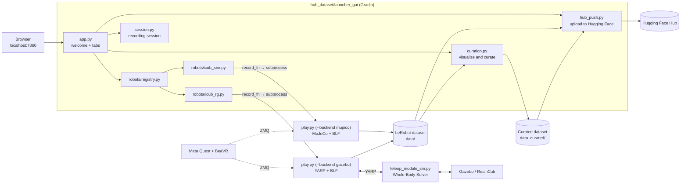

# Experimentation Hub

Web platform to **record, review, curate and publish robotics datasets** in
[LeRobot](https://github.com/huggingface/lerobot) format. Designed for **any robot**:
recording, episode review, curation and the upload to Hugging Face are shared, and each
robot plugs in as an independent *backend*
(see [How to add a robot](#how-to-add-a-robot-pending-validation)).

It currently has one integrated robot, the **iCub**, on three platforms: the **MuJoCo**
simulation, the **Gazebo** simulation and the **real iCub**. All three can be teleoperated
with a virtual reality headset (Meta Quest 2) using BeaVR, or interactively using mouse and keyboard in the graphical viewer.

- [Available platforms](#available-platforms)
- [VR headset](#vr-headset)
- [Viewer controls](#viewer-controls)
- [Console controls](#console-controls)
- [Installation](#installation)
- [How to use it](#how-to-use-it)
  - [MuJoCo](#mujoco)
  - [Gazebo / Real](#gazebo--real)
  - [Working with datasets (Hugging Face & local)](#working-with-datasets-hugging-face--local)
  - [Replaying a dataset in MuJoCo (reproducibility check)](#replaying-a-dataset-in-mujoco-reproducibility-check)
  - [Downloading & evaluating a trained policy](#downloading--evaluating-a-trained-policy)
- [Architecture](#architecture)
- [Hub modules](#hub-modules)
- [How to add a robot (Pending validation)](#how-to-add-a-robot-pending-validation)
- [Recorded data](#recorded-data)
- [Repository structure](#repository-structure)
- [Related documentation](#related-documentation)

---

## Available platforms

| Platform (welcome screen) | Backend | How it runs | Tasks |
|---|---|---|---|
| **iCub Simulated MJ** | `robots/icub_sim.py` | Separate subprocess (`play.py --backend mujoco`) | Block Lifting, Block Stacking, Pick-and-Place, Door Opening, Two-Arm Peg-In-Hole, Two-Arm Lifting |
| **iCub Real / Gazebo** | `robots/icub_rg.py` | Separate subprocess, connected to the robot through YARP | Block Lifting, Block Stacking, Pick-and-Place, Door Opening, Two-Arm Peg-In-Hole, Two-Arm Lifting |

- Tasks are declared once in `mujoco_sim/assets/scenes/scenes.yaml`, and Gazebo uses the same file.
  Each task can choose its cameras (`cameras`): Door Opening records `left`, `right` and the
  overhead `top` camera instead of `front`.
- In *Configuration*, both platforms choose the **Controller (solver)**, the BLF whole-body
  controller of `config/control_config.yaml`: **Whole-Body IK (position)**, **Whole-Body ID
  (torque)** or **Whole-Body ID (torque) + impedance**. On Gazebo / real the solver runs in the
  YARP module (step 2.2), which is started with the selected option.
- Joint limits of the 20 upper-body joints: `joint_limits_deg` in `config/control_config.yaml`
  is the only source. The solver (IK and ID), MuJoCo (joint ranges) and Gazebo (controlboards)
  use it; on the real robot only the solver does.
- Success criteria of the six tasks (robosuite's `_check_success`): [metrics/README.md](metrics/README.md).
- Both backends record **the same dataset**: same variables, in the same frame and with the same cameras. A dataset from one platform therefore works for the other (see [Recorded data](#recorded-data)).

---

## VR headset

Teleoperation uses the BeaVR app on a Meta Quest 2 / Quest Pro, connected over Wi-Fi (entering
the headset's IP in *Configuration*) or over a USB cable.

### Controls

| VR Control | Action |
|---|---|
| **Index trigger** | Hand closing, proportional: released = open, fully pressed = closed (a full close takes `hand_close_time_s` = 2 s, in every platform) |
| **Lower trigger (grip)** | Clutch: while pressed the hands' position stays put and the head freezes, so you can reposition the controller; on release the hand continues from where it stopped, without a jump. The orientation keeps following |
| **A** | Start episode recording |
| **B** | Stop and save episode (hold **B** for 1.5s to discard episode) |
| **Y** | Reposition / re-randomize scene objects |
| **X** | Help panel with these buttons on the big screen (it also shows while the BeaVR app is paused) |

The big screen shows the robot's eye with a wider field of view than the recorded camera
(`vr_head_fovy`, MuJoCo `head_cam_vr` / Gazebo VR camera) and the recording status in the
corner; the small screen shows the front camera.

### USB cable setup (one time only)

The cable connection goes through ADB, so the computer needs the Android tools and
permission to access the headset over USB. Do these steps on the host machine, also when
the Hub runs in Docker.

1. Enable **developer mode** on the headset from the Meta Horizon mobile app
   (*Devices → Headset settings → Developer mode*).
2. Install ADB.
   ```bash
   sudo apt install adb
   ```
3. Add a udev rule so your user can access the headset (`2833` is Meta's USB vendor ID),
   and add yourself to the `plugdev` group. Log out and back in afterwards.
   ```bash
   echo 'SUBSYSTEM=="usb", ATTR{idVendor}=="2833", MODE="0666", GROUP="plugdev"' \
     | sudo tee /etc/udev/rules.d/51-meta-quest.rules
   sudo udevadm control --reload-rules && sudo udevadm trigger
   sudo usermod -aG plugdev $USER
   ```
4. Connect the cable, put the headset on and accept **Allow USB debugging**
   (tick *Always allow from this computer*).
5. Check that the headset shows up as `device`.
   ```bash
   adb devices
   ```
   If it shows `unauthorized`, accept the prompt inside the headset again. If it does not
   show up at all, check the cable and the udev rule.

---

## Viewer controls

Interactive teleoperation via mouse and keyboard in the MuJoCo viewer (both MuJoCo and Gazebo backends):

| Input | Action |
|---|---|
| **Double-left-click** | Select mocap target (`r_hand_target` or `l_hand_target`) |
| **Ctrl + Right-Click Drag** | Translate mocap target position ($X, Y, Z$) |
| **Ctrl + Left-Click Drag** | Rotate mocap target orientation ($SO(3)$) |
| Key **8** | Open right hand gripper |
| Key **9** | Close right hand gripper |
| Key **6** | Open left hand gripper |
| Key **7** | Close left hand gripper |

*(Note: State controls such as homing, teleop pause/resume, and object reset are centralized in the console commands).*

---

## Console controls

Interactive commands entered in the terminal running `play.py` (both MuJoCo and Gazebo backends):

| Key / Command | Action |
|---|---|
| `1` | Start episode recording |
| `2` | Stop and save episode |
| `3` | Exit teleoperation cleanly |
| `h` | Return robot to home posture and reset mocaps |
| `n` | Reset tabletop object positions |
| `t` | Toggle teleoperation tracking (Active / Idle pause) |
| `i` | Toggle Cartesian impedance mode (when `--controller id` is used) |
| `8` / `9` | Open / close right hand gripper |
| `6` / `7` | Open / close left hand gripper |

---

## Installation

### With Pixi (Recommended)

The workspace is fully integrated with [Pixi](https://pixi.sh) to automatically manage all robotics, physics, and ML dependencies (MuJoCo, YARP, Gazebo Sim, BLF, LeRobot, PyTorch CUDA):

```bash
# 1. Install dependencies
pixi install

# 2. Launch the Experimentation Hub (Web GUI)
pixi run hub            # http://localhost:7860
```

Desktop icon (Ubuntu / GNOME): `src/hub_dataset/hub_launcher.sh install` creates
*Multimodal Experimentation Hub* on the desktop. Clicking it starts the Hub and opens the browser;
if the Hub is already running, it asks whether to open it in the browser or close it.

### With Docker

A single image contains the Hub, MuJoCo, Gazebo and the YARP client for the real robot:

```bash
docker compose build                  # initial build or when code changes
xhost +SI:localuser:$(id -un)         # authorize container to access X11 display
docker compose up                     # starts the Hub on http://localhost:7860
```

---

## How to use it

The Hub follows the order of its numbered tabs. On the welcome screen you choose the
platform, in **1. Configuration** you set up and launch the session (task, arms, solver, VR),
in **2. Episode Control** you record episodes with the VR headset, and in
**3. Visualize & Curate** you review, curate and publish the dataset, and in **4. Train** you
train a SmolVLA policy on it. The full walkthrough,
with screenshots of each tab, is in the [User manual](docs/MANUAL.md).

From the command line, `play.py` records (or only teleoperates, with `--no-record`) the same way:

### MuJoCo

Launch interactive bimanual teleoperation in MuJoCo:

```bash
# 1. With QP Inverse Kinematics (TSIK - iCubWholeBodyIK):
pixi run python play.py --backend mujoco --controller ik --control-arms both --no-record

# 2. With QP Task-Space Inverse Dynamics (TSID - iCubWholeBodyID):
pixi run python play.py --backend mujoco --controller id --control-arms both --no-record

# 3. With TSID + Compliant Cartesian Impedance Mode:
pixi run python play.py --backend mujoco --controller id --impedance --control-arms both --no-record
```

#### Arguments supported by `play.py`:

| Option | Values / Default | Description |
|---|---|---|
| `--backend` | `mujoco`, `gazebo`, `real` (default: `mujoco`) | Target simulation or physical backend |
| `--controller` | `ik`, `id` (default: `ik`) | Controller type: `ik` (TSIK kinematics) or `id` (TSID dynamics) |
| `--impedance` | flag | Enable compliant Cartesian impedance mode (requires `--controller id`) |
| `--control-arms` | `right`, `left`, `both` (default: `both`) | Active arm(s) to control |
| `--no-record` | flag | Interactive teleoperation only without recording dataset |
| `--vr` | flag | Enable Meta Quest VR teleoperation |
| `--vr-cable` | flag | Automatically configure ADB reverse tethering over USB-C cable |
| `--vr-ip` | IP string (e.g. `192.168.1.50`) | Connect to Meta Quest wirelessly over Wi-Fi |
| `--scene` | int or label (e.g. `1` or `lift`) | Select predefined task scene from `scenes.yaml` |
| `--single-task` | string | Natural language task description string |
| `--fps` | int (default: `30`) | Target control loop and dataset recording FPS |
| `--num-episodes` | int (default: `50`) | Number of episodes to record before auto-stopping |
| `--episode-time-s` | float (default: `0.0`) | Maximum duration per episode in seconds (`0` = manual) |
| `--repo-id` | string | LeRobot dataset repository identifier |
| `--root` | directory path | Output directory for recorded dataset |

---

### Gazebo / Real

To teleoperate the iCub in Gazebo Sim with both arms:

#### Step 1: Launch Gazebo Sim (Terminal 1)

```bash
./gazebo_sim/scripts/launch_sim.sh --world manip
```

##### Arguments supported by `launch_sim.sh`:

| Option | Values / Default | Description |
|---|---|---|
| `-w, --world` | `manip`, `empty` (default: `manip`) | Simulation world: `manip` (table arena with objects and camera) or `empty` |
| `-m, --model` | model name | iCub model: `iCubGazeboV2_5_visuomanip` (default for manip), `iCubGazeboV2_5_fixed`, `iCubGazeboV2_7_fixed`, `iCubGazeboV2_5`, `iCubGazeboV2_7` |
| `--stop`, `--kill` | flag | Stop and cleanup any running Gazebo Sim (`gz sim`) and YARP (`yarpserver`) processes |
| `-h, --help` | flag | Show usage help and exit |

#### Step 2: Launch Teleoperation (Terminal 2)

```bash
# 1. With QP Inverse Kinematics (TSIK - iCubWholeBodyIK):
pixi run python play.py --backend gazebo --controller ik --control-arms both --no-record

# 2. With QP Task-Space Inverse Dynamics (TSID - iCubWholeBodyID):
pixi run python play.py --backend gazebo --controller id --control-arms both --no-record

# 3. With TSID + Compliant Cartesian Impedance Mode:
pixi run python play.py --backend gazebo --controller id --impedance --control-arms both --no-record
```

*(Note: If `teleop_module_sm.py` is not already running on YARP, `play.py` automatically launches it in the background with the selected solver).*

---

### Working with datasets (Hugging Face & local)

#### Hugging Face authentication (for private repositories)

If you are accessing private datasets or checkpoints (for example under the `CAMADA-UTFSM` organization), authenticate once in the Pixi environment or export an access token:

```bash
# Option 1: Interactive login cached on your machine
pixi run hf auth login

# Option 2: Environment variable for the current shell session
export HF_TOKEN=hf_...
```

#### Option A: Download a dataset from Hugging Face

Download any LeRobot dataset into `data/<folder_name>` so that the **Experimentation Hub** web GUI (**3. Visualize & Curate** and **4. Train** after clicking **Refresh list**), `metrics/dataset_check.py`, and `replay_mujoco.py` detect it automatically:

```bash
pixi run hf download CAMADA-UTFSM/BlockStacking_wb_icub \
    --repo-type dataset \
    --local-dir data/CAMADA-UTFSM_BlockStacking_wb_icub
```

You can download any other dataset in the same way into a directory of your choice (e.g. `CAMADA-UTFSM/DoorOpening_wb_icub`, `CAMADA-UTFSM/PickandPlace_wb_icub`), or let `replay_mujoco.py` download it directly via `--repo-id` and `--download-dir` (shown below).

#### Option B: Use a local dataset & verify integrity

Locally recorded sessions live in `data/<repo_id>_<timestamp>/`, and curated packages generated from Tab **3. Visualize & Curate** live in `data_curated/<name>/`. Before replaying or training, you can verify Parquet row counts, monotonic timestamps, frozen-frame ratios, and MP4 camera streams with `metrics/dataset_check.py`:

```bash
# Full check across all episodes and cameras:
pixi run python metrics/dataset_check.py data/CAMADA-UTFSM_BlockStacking_wb_icub

# Quick smoke check on the first 5 episodes:
pixi run python metrics/dataset_check.py data/CAMADA-UTFSM_BlockStacking_wb_icub --max-episodes 5
```

---

### Replaying a dataset in MuJoCo (reproducibility check)

`replay_mujoco.py` (`pixi run replay ...`) replays recorded demonstrations in MuJoCo to verify physical reproducibility:

1. **Deterministic reset:** Places the iCub at `home_qpos` with open hands and settles physics for `0.5 s` (matching recording and policy evaluation).
2. **Exact initial scene restoration (`root` → `world`):** Reads frame `0` of `observation.state` (`obj0_pos_*` / `obj0_quat_*`, `obj1_pos_*` / `obj1_quat_*`, etc.), converts each object pose from the recorded iCub `root` frame back to MuJoCo `world` coordinates, and restores all tabletop objects (e.g. `blue-cube` and `red-cube` in *Block Stacking*) or door configuration before stepping actions.
3. **Whole-body action playback & verification:** Steps the recorded actions through TSIK (`--controller ik`) or TSID (`--controller id [--impedance]`), automatically inferring the scene and active arms (`both`, `right`, or `left`), and reports both task success ([metrics/README.md](metrics/README.md)) and Cartesian end-effector tracking error (`EE RMSE` in mm).

```bash
# 1. Download a dataset from Hugging Face into a custom folder and replay 5 episodes:
pixi run python replay_mujoco.py \
    --repo-id CAMADA-UTFSM/BlockStacking_wb_icub \
    --download-dir data/CAMADA-UTFSM_BlockStacking_wb_icub \
    --scene "Block Stacking" \
    --episodes 5

# 2. Replay specific 0-based episodes from a local dataset (with TSID + impedance):
pixi run python replay_mujoco.py \
    --root data/CAMADA-UTFSM_BlockStacking_wb_icub \
    --episode 0 4 9 \
    --controller id --impedance

# 3. Fast headless reproducibility audit across ALL episodes (saving a JSON report):
pixi run python replay_mujoco.py \
    --root data/CAMADA-UTFSM_BlockStacking_wb_icub \
    --episodes 0 --no-viewer --fast \
    --out outputs/replay/block_stacking_repro.json
```

> [!TIP]
> - Add `--skip-videos` when downloading with `--repo-id` if you only want to run MuJoCo physics replay without downloading the MP4 camera files.
> - If you are replaying a curated dataset in `data_curated/` from which `obj{i}_pos_*` / `obj{i}_quat_*` columns were removed, pass `--raw-root data/<original_dataset>` so `replay_mujoco.py` can still restore the exact frame-0 object poses.

#### Arguments supported by `replay_mujoco.py`:

| Option | Values / Default | Description |
|---|---|---|
| `--repo-id` | HF dataset ID or `local/*` | Hugging Face dataset repository to download/load (e.g. `CAMADA-UTFSM/BlockStacking_wb_icub`) |
| `--root` | directory path | Local dataset folder containing `meta/info.json` |
| `--download-dir` | directory path | Target folder where `--repo-id` is downloaded (default: `data/<org>_<dataset>`) |
| `--use-hf-cache` | flag | Download `--repo-id` into the standard Hugging Face cache instead of `data/` |
| `--force-download` | flag | Re-download dataset files from Hugging Face even if already present locally |
| `--skip-videos` | flag | Skip downloading `videos/**` from Hugging Face (only `meta/` and `data/` are needed for replay) |
| `--hf-token` | token string | Hugging Face access token for private datasets (falls back to `HF_TOKEN` or `hf auth login`) |
| `--raw-root` | directory path | Uncurated dataset path to read frame-0 `obj{i}_pos/quat` from when replaying a curated dataset |
| `--scene` | int or label | Scene from `scenes.yaml` (auto-inferred from dataset task/name when omitted) |
| `--controller` | `ik`, `id` (default: `ik`) | Whole-body controller: `ik` (TSIK) or `id` (TSID) |
| `--impedance` | flag | Enable compliant Cartesian impedance mode (requires `--controller id`) |
| `--control-arms` | `right`, `left`, `both` | Active arm(s) (default: inferred automatically from the dataset's action features) |
| `--episodes` | int (default: `10`) | Number of episodes to replay starting from `0` (`0` = replay all episodes) |
| `--episode` | int list (e.g. `0 4 9`) | Specific 0-based episode indices to replay (overrides `--episodes`) |
| `--fps` | int | Playback rate in Hz (default: dataset's recorded `fps` in `meta/info.json`) |
| `--fast` | flag | Step simulation at maximum CPU speed without real-time sleep |
| `--no-viewer` | flag | Run headless without opening the interactive MuJoCo viewer |
| `--door-side` | `left`, `right`, `auto` (default: `auto`) | Door Opening scene: handle side (`auto` infers it from the active arm trajectory) |
| `--door-xy` | `X Y` floats | Door Opening scene: world `(X, Y)` center of the door panel |
| `--out` | JSON file path | Save per-episode reproducibility and tracking metrics to a JSON file |

---

### Downloading & evaluating a trained policy

`eval_policy.py` (`pixi run eval ...`) evaluates a trained LeRobot VLA policy (such as SmolVLA) on **MuJoCo**, **Gazebo**, or the **real iCub**, using the task success criteria in [metrics/README.md](metrics/README.md). Every episode starts from `home` with open hands and randomized (or alternating mirrored) object placements.

#### Option A: Download a trained model from Hugging Face

You can either pre-download a checkpoint into any local folder with `hf download`, or let `eval_policy.py` download it directly via `--checkpoint <org/model> --download-dir <folder>`:

```bash
# Pre-download a trained checkpoint from Hugging Face into models/:
pixi run hf download CAMADA-UTFSM/<model_repo> \
    --repo-type model \
    --local-dir models/CAMADA-UTFSM_<model_repo>
```

#### Option B: Use a locally trained checkpoint

Training runs launched from Tab **4. Train** of the Hub save checkpoints under `output/train/<run_name>/checkpoints/last/pretrained_model` (as well as step snapshots such as `checkpoints/020000/pretrained_model`).

#### Running policy evaluation

```bash
# 1. Evaluate a local checkpoint trained in the Hub (20 episodes in MuJoCo):
pixi run python eval_policy.py \
    --checkpoint output/train/<run_name>/checkpoints/last/pretrained_model \
    --scene "Block Stacking" \
    --num-episodes 20

# 2. Download a Hugging Face checkpoint into models/ (or reuse if already downloaded) and evaluate:
pixi run python eval_policy.py \
    --checkpoint CAMADA-UTFSM/<model_repo> \
    --download-dir models/CAMADA-UTFSM_<model_repo> \
    --dataset-meta CAMADA-UTFSM/BlockStacking_wb_icub \
    --scene "Block Stacking" \
    --controller ik \
    --num-episodes 20

# 3. Evaluate in Gazebo Sim with TSID + Cartesian impedance:
pixi run python eval_policy.py \
    --checkpoint models/CAMADA-UTFSM_<model_repo> \
    --backend gazebo \
    --scene "Block Stacking" \
    --controller id --impedance \
    --num-episodes 10
```

> [!NOTE]
> When evaluating a checkpoint trained on another machine (or downloaded from Hugging Face), passing `--dataset-meta <local_dataset_dir_or_hf_repo_id>` (e.g. `--dataset-meta data/CAMADA-UTFSM_BlockStacking_wb_icub` or `--dataset-meta CAMADA-UTFSM/BlockStacking_wb_icub`) ensures `eval_policy.py` recovers the exact `observation.state` and `action` feature names even if the checkpoint was trained on a curated feature subset. If omitted, `eval_policy.py` automatically looks up `train_config.json` and local/remote `meta/info.json`.

#### Arguments supported by `eval_policy.py`:

| Option | Values / Default | Description |
|---|---|---|
| `--checkpoint` | path or HF model ID (required) | Local checkpoint directory (`.../pretrained_model`) or Hugging Face model repo ID (`CAMADA-UTFSM/...`) |
| `--download-dir` | directory path | Local folder where a Hugging Face `--checkpoint` repo ID should be downloaded |
| `--force-download` | flag | Re-download `--checkpoint` from Hugging Face when `--download-dir` is specified |
| `--dataset-meta` | path or HF dataset ID | Local dataset folder or HF dataset ID used to read exact `observation.state` and `action` feature names |
| `--hf-token` | token string | Hugging Face token for private models/datasets (falls back to `HF_TOKEN` or `hf auth login`) |
| `--backend` | `mujoco`, `gazebo`, `real` (default: `mujoco`) | Target evaluation platform |
| `--controller` | `ik`, `id` (default: `ik`) | Whole-body controller: `ik` (TSIK) or `id` (TSID) |
| `--impedance` | flag | Enable compliant Cartesian impedance mode (requires `--controller id`) |
| `--scene` | int or label | Task scene from `scenes.yaml` (e.g. `"Block Stacking"`, `"Block Lifting"`, `"Door Opening"`) |
| `--task` | string | Override the natural-language task prompt (default: prompt from `scenes.yaml`) |
| `--control-arms` | `right`, `left`, `both` | Active arm(s) (default: inferred from trained action names or action dimensionality) |
| `--num-episodes` | int (default: `10`) | Number of rollout episodes |
| `--episode-len` | int (default: `600`) | Maximum control steps per episode (`600` steps = `20 s` at `30 Hz`) |
| `--fps` | int (default: `30`) | Control frequency in Hz |
| `--n-action-steps` | int (`1..chunk_size`) | Number of actions executed per predicted chunk before re-querying the policy |
| `--side` | `right`, `left` | MuJoCo: fix the task side on every episode instead of alternating |
| `--mirror` | `alternate`, `random` (default: `alternate`) | MuJoCo two-sided scenes: `alternate` flips right/left every episode; `random` draws 50/50 |
| `--seed` | int | Random seed for MuJoCo object spawn resets |
| `--device` | `cuda`, `cpu` (default: `cuda`) | Torch inference device |
| `--no-viewer` | flag | Run headless without opening MuJoCo or OpenCV camera windows |
| `--no-video` | flag | Disable saving MP4 recordings of the policy cameras |
| `--out` | directory path | Output directory (default: `outputs/eval/<name>_<backend>_<YYYYMMDD-HHMMSS>`) |

#### Understanding evaluation outputs

Each evaluation run writes to `outputs/eval/<name>_<backend>_<date>/` (rewritten after every episode so interrupted runs keep partial results):

- **`summary.json`**:
  - `success_rate` / `results.success_rate_pct`: fraction of episodes where the task criterion held (at any step for general tasks; on the final state for *Block Stacking*).
  - `success_at_end_rate` / `results.success_at_end_rate_pct`: fraction of episodes where the criterion still holds at the final step.
  - `results.success_rate_by_side` / `results.success_rate_by_blue_side`: per-side breakdown (`left` vs. `right`) to inspect bimanual symmetry and spatial generalization.
  - `episodes`: per-episode breakdown including `initial_objects`, `success_step`, `success_time_s`, `infer_ms_mean` / `infer_ms_max`, and `video_start_s` / `video_end_s`.
- **`videos/<camera>.mp4`**: continuous RGB recordings of what each policy camera observed across all episodes (indexed by `video_start_s` and `video_end_s` in `summary.json`).
- **`eval.log`**: full console log of the run. On the real robot (`--backend real`), the operator places the objects before each episode and confirms whether the rollout succeeded.

---

## Architecture



---

## Hub modules

Modules located in `src/hub_dataset/launcher_gui/`:

| Module | What it does |
|---|---|
| `app.py` | Builds the interface (welcome screen, tabs, CSS) and wires each component to its logic |
| `robots/base.py`, `robots/registry.py` | Backend contract and list of available backends |
| `robots/icub_sim.py`, `robots/icub_rg.py` | Form and launch of each platform |
| `robots/solver.py` | *Controller (solver)* selector shared by both platforms |
| `session.py` | Session thread, command queue, status, log and the *Episode Control* poller |
| `session_log.py` | Per-episode metrics and logbook (the dataset's `hub_session/`) |
| `curation.py` | Dataset loading, episode navigation, plots, deletion and packaging |
| `dataset_curation.py` | Packaging of the curated dataset (episodes, features and dimensions dropped, instructions) |
| `hub_push.py` | Upload to Hugging Face Hub |
| `video_sync.py` | Player for the three cameras, synchronized with the plots |
| `procman.py` | Long-lived external processes (e.g. the YARP module) and scripts (`launch_sim.sh`) |
| `ports.py` | Checks and frees the VR ports before launching a session |
| `state.py` | State shared between modules |
| `ui/` | Construction of each tab, folder picker and numeric field filters |

---

## How to add a robot (Work in progress)

> [!NOTE]
> This capability represents the multi-robot architectural blueprint; it has not yet been experimentally verified with a second physical or simulated robot platform.

To add a new robot, create its backend form and register it:

**1. Create `hub_dataset/launcher_gui/robots/my_robot.py`:**

```python
from datetime import datetime
from pathlib import Path
import gradio as gr
from .. import session
from ..paths import ASSETS_DIR, HUB_ROOT
from .base import RobotBackend

def build_config_form() -> dict[str, gr.components.Component]:
    gr.Markdown("### 1. Session settings")
    repo_id = gr.Textbox(value="local/my_robot_demo", label="Repo ID")
    num_eps = gr.Number(value=50, label="Number of episodes", precision=0, minimum=1)
    gr.Markdown("### 2. Launch session")
    launch_btn = gr.Button("LAUNCH SESSION", variant="primary", size="lg")
    launch_status = gr.Textbox(label="Launch status", interactive=False)
    return dict(repo_id=repo_id, num_eps=num_eps,
                launch_btn=launch_btn, launch_status=launch_status)

def launch(repo_id, num_eps) -> str:
    if session.state.running:
        return "A session is already running."
    rid = repo_id.strip() if "/" in repo_id else f"local/{repo_id.strip()}"
    stamp = datetime.now().strftime("%Y-%m-%d_%H-%M-%S")
    dataset_root = HUB_ROOT.parent / "data" / f"{rid.replace('/', '_')}_{stamp}"

    def record_fn(cmd_source, on_status):
        ...

    return session.start_session(record_fn, repo_id=rid, dataset_root=dataset_root,
                                 num_episodes=int(num_eps))

BACKEND = RobotBackend(
    id="my_robot",
    label="My Robot",
    image=ASSETS_DIR / "my_robot.png",
    available=True,
    build_config_form=build_config_form,
    launch=launch,
    config_input_order=["repo_id", "num_eps"],
)
```

**2. Register it in `hub_dataset/launcher_gui/robots/registry.py`:**

```python
from . import icub_rg, icub_sim, my_robot

REGISTRY = [icub_sim.BACKEND, icub_rg.BACKEND, my_robot.BACKEND]
```

---

## Recorded data

Both iCub backends record identical variables, ensuring datasets are interchangeable:

- **Action:** Target pose of each hand (Cartesian position $[x, y, z]$ and unit quaternion $[w, x, y, z]$ in robot root frame), gripper closure level ($[0.0, 1.0]$), and head orientation quaternion.
- **State:**
  - Joint positions, velocities, and motor torques.
  - End-effector Cartesian poses and last commanded poses.
  - Scene object ground-truth poses from simulation.
- **Cameras:** `left` and `right` (iCub eyes) and `front` (external table camera), standard $320 \times 240$ RGB. A task can choose others in `scenes.yaml` (`cameras`), e.g. the overhead `top` camera of Door Opening.
- **Scene objects absent from a task** (e.g. no cube in Door Opening) are recorded as zeros.
- **Arm selection:** Only the arm(s) chosen in `--control-arms` are populated.
- **Quaternion canonicalization:** Positive scalar part ($q_w \geq 0$) to eliminate sign ambiguity jumps.

---

## Repository structure

```
PMM_Final/
├── pixi.toml                    # Pixi environment and task specification
├── pixi.lock                    # Deterministic reproducible lockfile
├── play.py                      # Unified teleoperation and LeRobot dataset recording entrypoint
├── eval_policy.py               # Unified evaluation entrypoint for trained VLA policies
├── train_policy.py              # LeRobot policy training wrapper
├── replay_mujoco.py             # Replay recorded manipulation datasets in MuJoCo
├── config/
│   └── control_config.yaml      # Central configuration: BLF solvers, camera shapes, and teleop settings
├── src/                         # Unified Python source code
│   ├── controllers/             # BLF Whole-Body QP Inverse Kinematics (TSIK) & Dynamics (TSID)
│   ├── interfaces/              # YARP module (teleop_module_sm.py), BLFRobotBridge, teleop MuJoCo, and VR
│   ├── plugins/                 # LeRobot plugins (icub_mujoco, icub_remote, icubteleop)
│   ├── hub_dataset/             # Experimentation Hub (Gradio web app, live metrics, curation, HF upload)
│   ├── trajectories/            # Analytical trajectory generator routines
│   └── tools/                   # Quaternion canonicalization, offsets, etc.
├── mujoco_sim/                  # MuJoCo simulation assets (scenes XML, OBJ meshes, textures)
├── gazebo_sim/                  # Gazebo simulation assets (worlds SDF, models, plugins, scripts)
├── metrics/                     # Latency / jitter / frame metrics and the tasks' success criteria (task_success.py)
├── docs/                        # User manual of the Hub
├── docker/                      # Alternative Docker container setup
├── data/                        # Recorded datasets (unversioned)
└── data_curated/                # Curated datasets (unversioned)
```

---

## Related documentation

| Document | Contents |
|---|---|
| [docs/MANUAL.md](docs/MANUAL.md) | User manual of the Hub, tab by tab, with screenshots |
| [docker/README.md](docker/README.md) | Docker image: requirements, volumes, real robot, VR ports, updating the environment |
| [gazebo_sim/README.md](gazebo_sim/README.md) | Gazebo simulation assets and environment setup |
| [metrics/README.md](metrics/README.md) | How to measure latency, jitter and synchronization of recordings |
