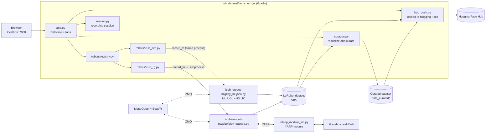

# Experimentation Hub

**English** | [Español](README.es.md)

Web platform to **record, review, curate and publish robotics datasets** in
[LeRobot](https://github.com/huggingface/lerobot) format. Designed for **any robot**:
recording, episode review, curation and the upload to Hugging Face are shared, and each
robot plugs in as an independent *backend*
(see [How to add a robot](#how-to-add-a-robot)).

It currently has one integrated robot, the **iCub**, on three platforms: the **MuJoCo**
simulation, the **Gazebo** simulation and the **real iCub**. All three are teleoperated
with a virtual reality headset (Meta Quest 2), using a modified version of the **BeaVR**
app.

**Step-by-step guide:** [User manual](docs/MANUAL.md)

**Index:**

- [Available platforms](#available-platforms)
- [Installation and startup](#installation-and-startup)
- [VR headset](#vr-headset)
- [How to use it](#how-to-use-it)
- [Architecture](#architecture)
- [How to add a robot](#how-to-add-a-robot)
- [Recorded data](#recorded-data)
- [Repository structure](#repository-structure)
- [Related documentation](#related-documentation)

---

## Available platforms

| Platform (welcome screen) | Backend | How it runs | Tasks |
|---|---|---|---|
| **iCub Simulated MJ** | `robots/icub_sim.py` | Inside the Hub process (MuJoCo 3.3) | Block Lifting, Block Stacking, Pick-and-Place, Door Opening, Two-Arm Peg-In-Hole, Two-Arm Lifting |
| **iCub Real / Gazebo** | `robots/icub_rg.py` | Separate subprocess, connected to the robot through YARP | Block Lifting, Block Stacking, Pick-and-Place, Door Opening, Two-Arm Peg-In-Hole, Two-Arm Lifting |

- Tasks are declared once in a shared manifest, `shared/scenes/scenes.yaml`, which both
  simulators read.
- Both backends record **the same dataset**, with the same variables, frame and cameras,
  so a dataset from one platform also works for the other
  (see [Recorded data](#recorded-data)).

---

## Installation and startup

### With Docker (recommended)

A single image contains the Hub, MuJoCo, Gazebo and the YARP client for the real robot.
It requires Linux with X11, an NVIDIA GPU with the NVIDIA Container Toolkit and about
25 GB of free space.

```bash
docker compose build                  # the first time; afterwards only when the code changes
xhost +SI:localuser:$(id -un)         # lets the container open windows
docker compose up                     # starts the Hub
```

Then open <http://localhost:7860>. Datasets are saved in the host's `./data` and
`./data_curated`. Volumes, real robot, VR ports and how to update the environment are
described in [docker/README.md](docker/README.md).

### Without Docker

The environment is `icubenv`, with Python 3.12, YARP 3.12, gz-sim 10, MuJoCo 3.3,
torch 2.7 and LeRobot v0.5.0+18. It is reproduced exactly from the lockfiles used by the
image.

```bash
conda create -n icubenv --file docker/conda-linux-64.lock
conda activate icubenv
pip install --no-deps --ignore-installed -r docker/requirements.lock.txt
pip install --no-deps "lerobot @ git+https://github.com/huggingface/lerobot.git@017ff73fbfe46bf9a673cd9b402988dcb79151f7"
python hub_dataset/hub_experimentacion.py                       # http://localhost:7860
```

The patched Gazebo controlboard (`icub-lerobot-gazebo/gazebo/plugins/*.so`) comes already
compiled for this environment. If it does not load, rebuild it with
`bash icub-lerobot-gazebo/gazebo/plugins/build_controlboard.sh`.

---

## VR headset

Teleoperation uses the BeaVR app on a Meta Quest 2, connected over Wi-Fi (entering the
headset's IP in *Configuration*) or over a USB cable.

### Controls

| Control | Action |
|---|---|
| **A** | Start recording an episode |
| **B** | Stop recording and save the episode |
| **X** | Pause or resume teleoperation, to reposition yourself without moving the robot |
| **Y** | Reset the scene (repositions the objects) |
| **Grip** (lower trigger, middle finger) | Open and close the hand gradually |

Without VR, MuJoCo also accepts the viewer's keyboard. `8`/`9` open and close the right
hand, `6`/`7` the left one, and `N` repositions the objects.

### USB cable setup (one time only)

The cable connection goes through ADB, so the computer needs the Android tools and
permission to access the headset over USB. Do these steps on the host machine, also when
the Hub runs in Docker.

1. Enable **developer mode** on the headset from the Meta Horizon mobile app
   (*Devices → Headset settings → Developer mode*).
2. Install ADB.
   ```bash
   sudo apt install adb
   ```
3. Add a udev rule so your user can access the headset (`2833` is Meta's USB vendor ID),
   and add yourself to the `plugdev` group. Log out and back in afterwards.
   ```bash
   echo 'SUBSYSTEM=="usb", ATTR{idVendor}=="2833", MODE="0666", GROUP="plugdev"' \
     | sudo tee /etc/udev/rules.d/51-meta-quest.rules
   sudo udevadm control --reload-rules && sudo udevadm trigger
   sudo usermod -aG plugdev $USER
   ```
4. Connect the cable, put the headset on and accept **Allow USB debugging**
   (tick *Always allow from this computer*).
5. Check that the headset shows up as `device`.
   ```bash
   adb devices
   ```
   If it shows `unauthorized`, accept the prompt inside the headset again. If it does not
   show up at all, check the cable and the udev rule.

---

## How to use it

The Hub follows the order of its numbered tabs. On the welcome screen you choose the
platform, in **1. Configuration** you set up and launch the session, in
**2. Episode Control** you record episodes with the VR headset, and in
**3. Visualize & Curate** you review, curate and publish the dataset.

The full walkthrough, with screenshots of each tab, is in the
[User manual](docs/MANUAL.md).

Each dataset is saved in `data/<repo_id>_<date>/` and includes a `hub_session/` subfolder
with the per-episode metrics (`episode_metrics.json/.csv/.png`) and the logbook notes
(`logbook.json/.txt`). Curated datasets are saved separately in `data_curated/`.

---

## Architecture



### Hub modules (`hub_dataset/launcher_gui/`)

| Module | What it does |
|---|---|
| `app.py` | Builds the interface (welcome screen, tabs, CSS) and wires each component to its logic |
| `robots/base.py`, `robots/registry.py` | Backend contract and list of available backends |
| `robots/icub_sim.py`, `robots/icub_rg.py` | Form and launch of each platform |
| `session.py` | Session thread, command queue, status, log and the *Episode Control* poller |
| `session_log.py` | Per-episode metrics and logbook (the dataset's `hub_session/`) |
| `curation.py` | Dataset loading, episode navigation, plots, deletion and packaging |
| `hub_push.py` | Upload to Hugging Face Hub |
| `video_sync.py` | Player for the three cameras, synchronized with the plots |
| `procman.py` | Long-lived external processes (e.g. the YARP module) and scripts (`start_sim.sh`) |
| `ports.py` | Checks and frees the VR ports before launching a session |
| `state.py` | State shared between modules |
| `ui/` | Construction of each tab, folder picker and numeric field filters |

Only **one recording session can be active at a time**.

---

## How to add a robot

Adding a robot takes a new file in `robots/` and one line in the registry.

**1. Create `hub_dataset/launcher_gui/robots/my_robot.py`.**

```python
from datetime import datetime
from pathlib import Path

import gradio as gr

from .. import session
from ..paths import ASSETS_DIR, HUB_ROOT
from .base import RobotBackend


def build_config_form() -> dict[str, gr.components.Component]:
    """Components of the Configuration tab (already inside a gr.Column)."""
    gr.Markdown("### 1. Session settings")
    repo_id = gr.Textbox(value="local/my_robot_demo", label="Repo ID")
    num_eps = gr.Number(value=50, label="Number of episodes", precision=0, minimum=1)
    gr.Markdown("### 2. Launch session")
    launch_btn = gr.Button("LAUNCH SESSION", variant="primary", size="lg")
    launch_status = gr.Textbox(label="Launch status", interactive=False)
    # num_eps, launch_btn and launch_status are required: app.py uses them by name
    return dict(repo_id=repo_id, num_eps=num_eps,
                launch_btn=launch_btn, launch_status=launch_status)


def launch(repo_id, num_eps) -> str:
    """Receives the form values in the order of config_input_order."""
    if session.state.running:
        return "A session is already running."
    rid = repo_id.strip() if "/" in repo_id else f"local/{repo_id.strip()}"
    stamp = datetime.now().strftime("%Y-%m-%d_%H-%M-%S")
    dataset_root = HUB_ROOT.parent / "data" / f"{rid.replace('/', '_')}_{stamp}"

    def record_fn(cmd_source, on_status):
        # Connect the robot, create the LeRobotDataset in dataset_root and, in a loop:
        #   cmd = cmd_source()   -> "1" start, "2" save, "3" exit, None
        #   on_status("waiting") / on_status("recording") / on_status(f"saved:{n}")
        #   on_status({"metrics": {"fps": ..., "latency_ms": ..., "size_mb": ...}})
        ...

    return session.start_session(record_fn, repo_id=rid, dataset_root=dataset_root,
                                 num_episodes=int(num_eps))


BACKEND = RobotBackend(
    id="my_robot",
    label="My Robot",                       # button text on the welcome screen
    image=ASSETS_DIR / "my_robot.png",      # button image
    available=True,                         # False: the button only says "not yet available"
    build_config_form=build_config_form,
    launch=launch,
    config_input_order=["repo_id", "num_eps"],  # form keys, in the order of launch()
)
```

**2. Register it** in [robots/registry.py](hub_dataset/launcher_gui/robots/registry.py).

```python
from . import icub_rg, icub_sim, my_robot

REGISTRY = [icub_sim.BACKEND, icub_rg.BACKEND, my_robot.BACKEND]
```

**3. Add its image** to `hub_dataset/assets/` and, if its code lives in a sibling project
(like `icub-lerobot-mj/`), its path in [paths.py](hub_dataset/launcher_gui/paths.py).

With that, the platform shows up on the welcome screen, has its form in *Configuration*,
and *Episode Control*, *Visualize & Curate* and the upload work unchanged.

**Recommendations**

- **Choose the execution pattern.** If the robot's dependencies can coexist with the
  Hub's, `record_fn` can run in the same process (like `icub_sim`). Otherwise, use a
  subprocess with an input/output bridge, like `_bridge_play` in `icub_rg.py`.
- **Launch long-lived auxiliary processes** (drivers, servers) with `procman.py`, so their
  output shows up in the Hub log.
- **Use the same variable names, frames and cameras** as the iCub backends if you want
  datasets that are interchangeable with theirs (see [Recorded data](#recorded-data)).
- **For Docker,** install any new packages in `icubenv`, regenerate the lockfiles with
  `docker/freeze_env.sh` and rebuild the image.

---

## Recorded data

Both iCub backends record the same variables, so a MuJoCo dataset and a Gazebo dataset
are interchangeable.

- **Action.** Target pose of each hand (position and quaternion, in the iCub *root*
  frame), the gripper closure from 0 to 1 and the gaze point.
- **State.** Joint position, velocity and torque, end-effector pose, last command sent,
  touch on the thumb, index and middle fingers, and the pose of the scene objects. The
  object poses are simulator *ground truth* and are not available on the real robot.
- **Cameras.** `left` and `right` are the iCub's eyes and `front` is an external camera,
  all recorded at 320×240. The real robot has no front camera.
- **Only the arm chosen** in *Control arms* is recorded.
- **Quaternions have a fixed sign** (hand with `quat_y ≤ 0`, objects with `quat_w ≥ 0`)
  in both simulators, which avoids jumps between `q` and `−q`.
- **Gazebo and the real robot also record the eye joints** (`eyes_*`), which MuJoCo does
  not model.

The full contract, including the differences that remain between simulators, is in the
*Sim-to-sim* section of [icub-lerobot-gazebo/README.md](icub-lerobot-gazebo/README.md)
(in Spanish).

---

## Repository structure

```
PMM_Final/
├── hub_dataset/                 # the Hub
│   ├── hub_experimentacion.py   # entry point (python hub_dataset/hub_experimentacion.py)
│   ├── launcher_gui/            # Hub code (see Architecture)
│   ├── assets/                  # logos and images of the welcome screen
│   └── logs/                    # full log of each run
├── icub-lerobot-mj/             # MuJoCo backend: simulation, IK, VR teleoperation, LeRobot plugins
├── icub-lerobot-gazebo/         # Gazebo / real robot backend: Gazebo world, YARP module, LeRobot plugins
├── shared/scenes/               # scene manifest shared by both simulators
├── metrics/                     # latency, jitter and synchronization of the recordings
├── docs/                        # user manual and its screenshots
├── docker/                      # Dockerfile, environment lockfiles and their README
├── docker-compose.yml
├── data/                        # recorded datasets (not versioned)
└── data_curated/                # curated datasets (not versioned)
```

---

## Related documentation

| Document | Contents |
|---|---|
| [docs/MANUAL.md](docs/MANUAL.md) | User manual, step by step with screenshots |
| [docker/README.md](docker/README.md) | Docker image: requirements, volumes, real robot, VR ports, updating the environment |
| [icub-lerobot-gazebo/README.md](icub-lerobot-gazebo/README.md) | Gazebo / real robot stack (YARP), configuration and *sim-to-sim* data contract |
| [icub-lerobot-gazebo/gazebo/README.md](icub-lerobot-gazebo/gazebo/README.md) | Scripts to start and stop the Gazebo simulation |
| [icub-lerobot-mj/lerobot-robot-icub/README.md](icub-lerobot-mj/lerobot-robot-icub/README.md) | LeRobot plugin for the iCub in MuJoCo |
| [metrics/README.md](metrics/README.md) | How to measure latency, jitter and synchronization of the recordings |
