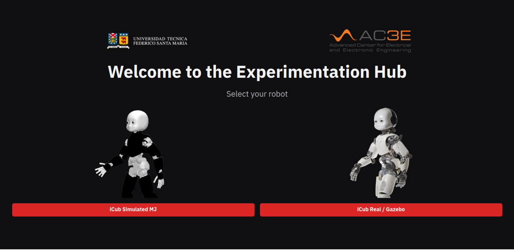
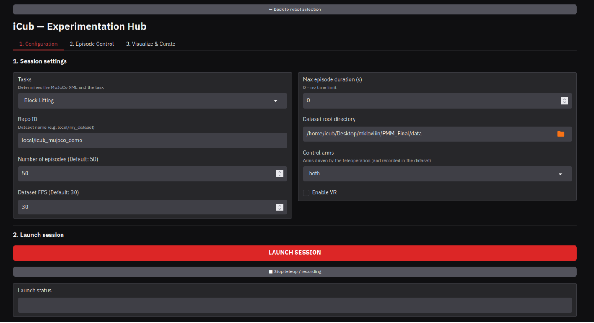
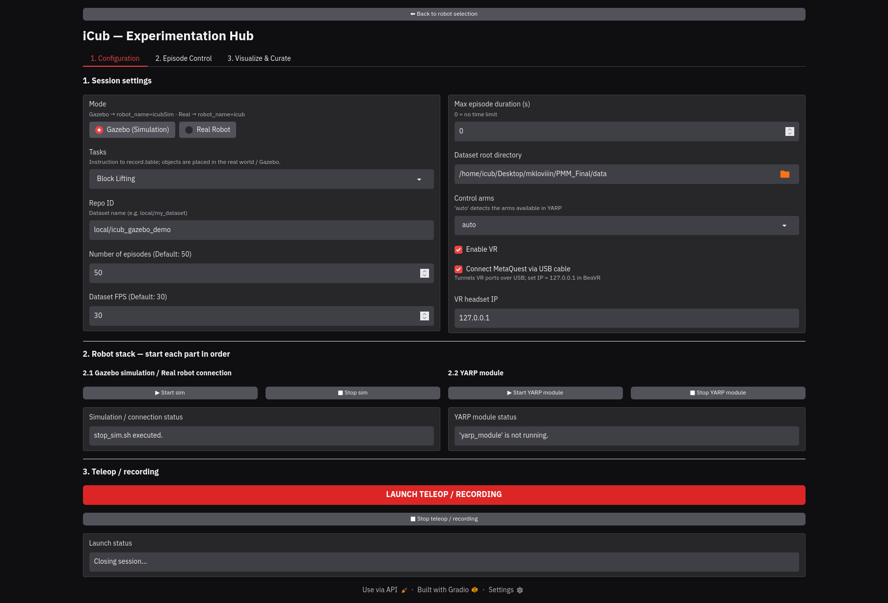
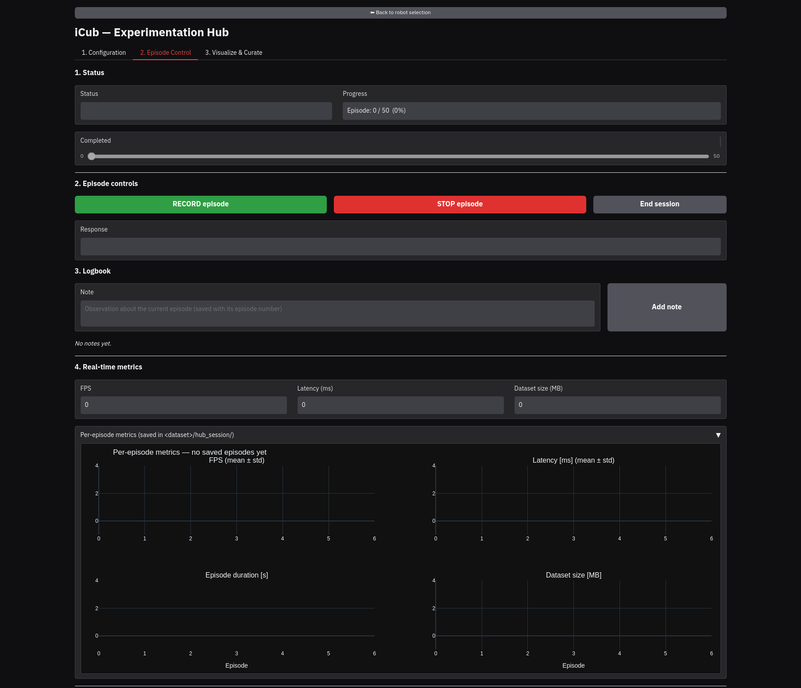
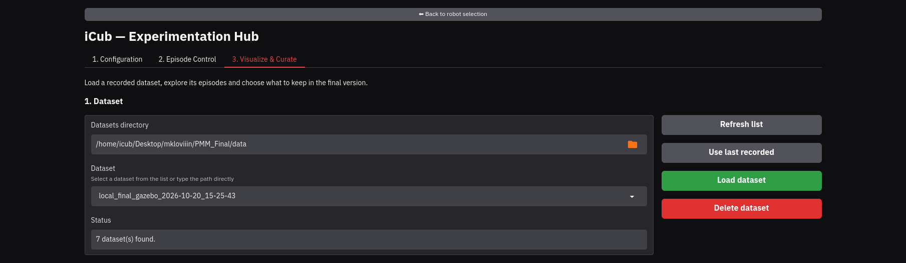
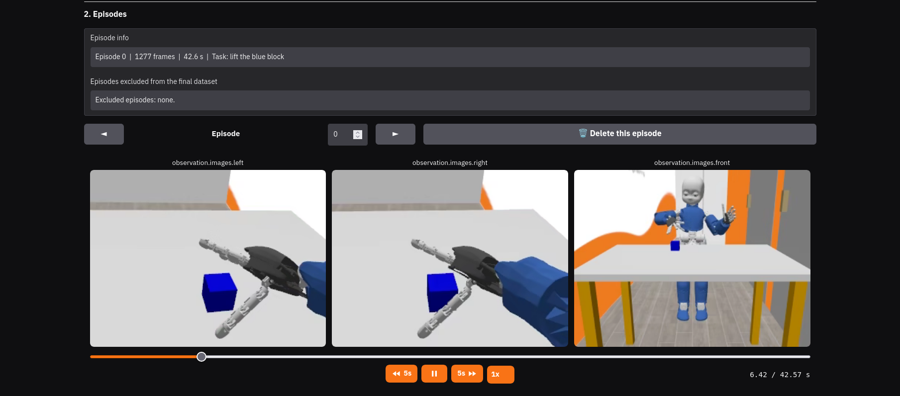
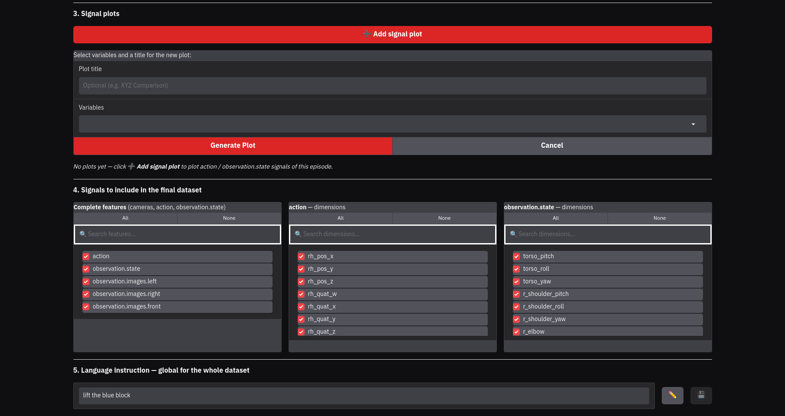
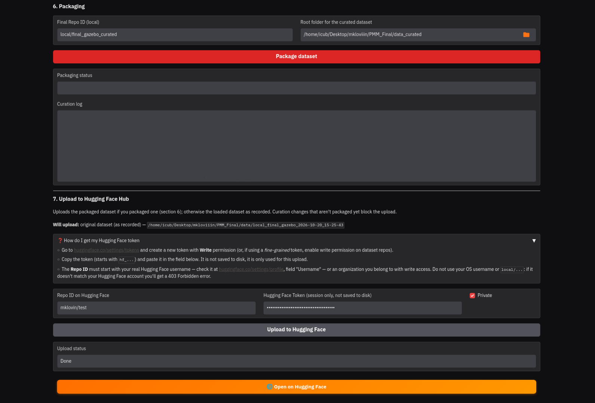

# Manual de uso · Experimentation Hub

[English](MANUAL.md) | **Español** · [Volver al README](../README.es.md)

Este manual recorre una sesión completa, desde elegir la plataforma hasta publicar el
dataset en Hugging Face. La instalación y la configuración de las gafas VR están en el
[README](../README.es.md#instalación-y-arranque).

- [Antes de empezar](#antes-de-empezar)
- [Pantalla de bienvenida](#pantalla-de-bienvenida)
- [1. Configuration](#1-configuration)
- [2. Episode Control](#2-episode-control)
- [3. Visualize & Curate](#3-visualize--curate)
- [Dónde se guardan los datos](#dónde-se-guardan-los-datos)
- [Solución de problemas](#solución-de-problemas)

---

## Antes de empezar

- El Hub está corriendo y abierto en <http://localhost:7860>.
- Las Meta Quest 2 tienen instalada la aplicación BeaVR y están conectadas por Wi-Fi o por
  cable USB (ver [Gafas VR](../README.es.md#gafas-vr)).
- Para el **iCub real**, el computador está en la red del robot y su servidor de nombres
  YARP está activo.

---

## Pantalla de bienvenida

Elige la plataforma con la que vas a grabar. **iCub Simulated MJ** corre la simulación en
MuJoCo, e **iCub Real / Gazebo** funciona tanto con la simulación en Gazebo como con el
robot físico.

---

## 1. Configuration

### Parámetros de la sesión

Completa los parámetros de la sesión.

| Campo | Qué es |
|---|---|
| **Task** | Escena a grabar (Block Lifting, Pick-and-Place, …) |
| **Repo ID** | Nombre del dataset, por ejemplo `local/icub_block_lifting` |
| **Number of episodes** | Cuántos episodios grabará la sesión |
| **FPS** | Frecuencia de grabación (30 por defecto) |
| **Max duration** | Duración máxima de cada episodio en segundos (0 = sin límite) |
| **Data folder** | Dónde se guarda el dataset |
| **Control arms** | Qué brazos se teleoperan y graban |
| **VR connection** | Cable USB, o la IP de las gafas para Wi-Fi |

### Robot stack (solo Gazebo / real)

En la plataforma *iCub Real / Gazebo*, levanta el lado del robot en orden antes de lanzar
la sesión.

1. **Inicia la simulación** (modo Gazebo) o **conéctate al robot** (modo real). El
   indicador de estado se pone verde cuando está listo.
2. **Inicia el módulo YARP**, que es el componente que comanda al robot.

### Lanzar la sesión

Presiona **LAUNCH SESSION** (MuJoCo) o **LAUNCH TELEOP / RECORDING** (Gazebo / real). El
estado de lanzamiento indica si la sesión partió bien, y el Hub pasa a *Episode Control*.

---

## 2. Episode Control

### Grabar con las gafas VR

Ponte las gafas. Verás la imagen de los ojos del robot y la vista frontal, junto con el
estado de la grabación.

| Control | Acción |
|---|---|
| **A** | Iniciar la grabación de un episodio |
| **B** | Terminar la grabación y guardar el episodio |
| **X** | Pausar o reanudar la teleoperación, para reacomodarse sin mover el robot |
| **Y** | Reiniciar el escenario (reposiciona los objetos) |
| **Grip** (gatillo inferior, dedo medio) | Abrir y cerrar la mano de forma gradual |

Un episodio típico se graba así.

1. Presiona **Y** si quieres los objetos en una posición nueva.
2. Presiona **A** y realiza la tarea.
3. Presiona **B** al terminar, y el episodio se guarda.
4. Usa **X** cada vez que necesites reacomodarte entre episodios.

### La pestaña Episode Control

Los botones **RECORD episode**, **STOP episode** y **End session** hacen lo mismo que los
controles de las gafas, lo que sirve cuando otra persona asiste al operador. La pestaña
muestra además el estado de la sesión, el progreso (episodios guardados de los
planificados), las métricas en vivo (FPS, latencia, tamaño del dataset), las métricas por
episodio y el registro en vivo.

En la **Bitácora** puedes escribir notas sobre el episodio en curso, por ejemplo si el
agarre falló o pasó algo inesperado. Cada nota se guarda con el número del episodio.

Cuando termines de grabar todos los episodios, presiona **End session**.

---

## 3. Visualize & Curate

### Elegir el dataset

Selecciona un dataset de la lista y cárgalo. Desde aquí también puedes borrar un dataset,
que se envía a la papelera del sistema después de pedir confirmación.

### Revisar los episodios

Recorre los episodios con las tres cámaras reproduciéndose sincronizadas. Una sola barra
controla todas, y una línea vertical sigue el tiempo del video sobre cada gráfico. Al hacer
clic en un gráfico, los videos saltan a ese instante. Marca los episodios que deben quedar
fuera del dataset final, por ejemplo los intentos fallidos.

### Gráficos, señales e instrucción

- **Gráficos de señales.** Grafica cualquier dimensión de `action` u `observation.state`
  sobre el video, y exporta los gráficos a HTML o PDF.
- **Señales a incluir.** Quita *features* completas o dimensiones sueltas. El buscador
  filtra la lista para encontrarlas rápido.
- **Instrucción en lenguaje.** Edita la instrucción de la tarea para todo el dataset.

### Empaquetar y subir

1. **Empaqueta** para generar el dataset curado como una copia aparte en `data_curated/`.
2. **Sube a Hugging Face Hub** con tu usuario y *token*. La línea *Will upload* indica si
   se subirá el dataset empaquetado o el original. Si hay cambios de curación sin
   empaquetar, la subida se bloquea hasta que los empaquetes.

---

## Dónde se guardan los datos

| Ubicación | Contenido |
|---|---|
| `data/<repo_id>_<fecha>/` | Dataset grabado en formato LeRobot |
| `data/<repo_id>_<fecha>/hub_session/` | Métricas por episodio y notas de la bitácora |
| `data_curated/` | Datasets curados |
| `hub_dataset/logs/` | Registro completo de cada ejecución del Hub |

La subida a Hugging Face incluye las carpetas `data/`, `meta/` y `videos/`.

---

## Solución de problemas

| Problema | Qué hacer |
|---|---|
| `adb devices` muestra las gafas como `unauthorized` | Ponte las gafas y acepta *Permitir depuración USB* |
| Las gafas no aparecen en `adb devices` | Revisa el cable y la regla udev del [README](../README.es.md#conexión-por-cable-usb-una-sola-vez) |
| Un puerto del VR está ocupado al lanzar | El Hub libera los puertos que dejan sus propias sesiones. Si los tiene otro programa, el estado de lanzamiento indica cuál |
| La ventana de Gazebo o MuJoCo no abre en Docker | Ejecuta `xhost +SI:localuser:$(id -un)` antes de `docker compose up` |
| El robot no se mueve en Gazebo / real | Revisa que la simulación (o la conexión al robot) y el módulo YARP estén ambos en verde en *Robot stack* |
| La subida está bloqueada | Hay cambios de curación sin empaquetar. Empaqueta el dataset primero |
