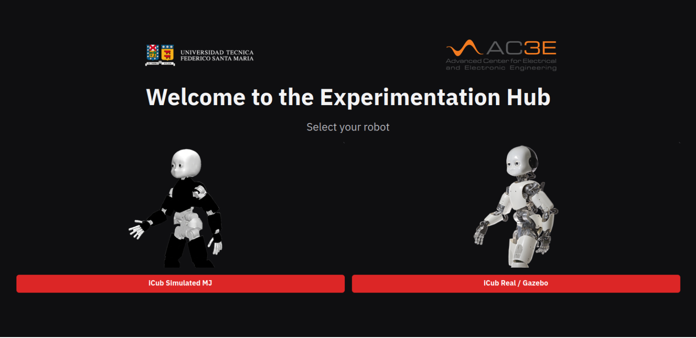
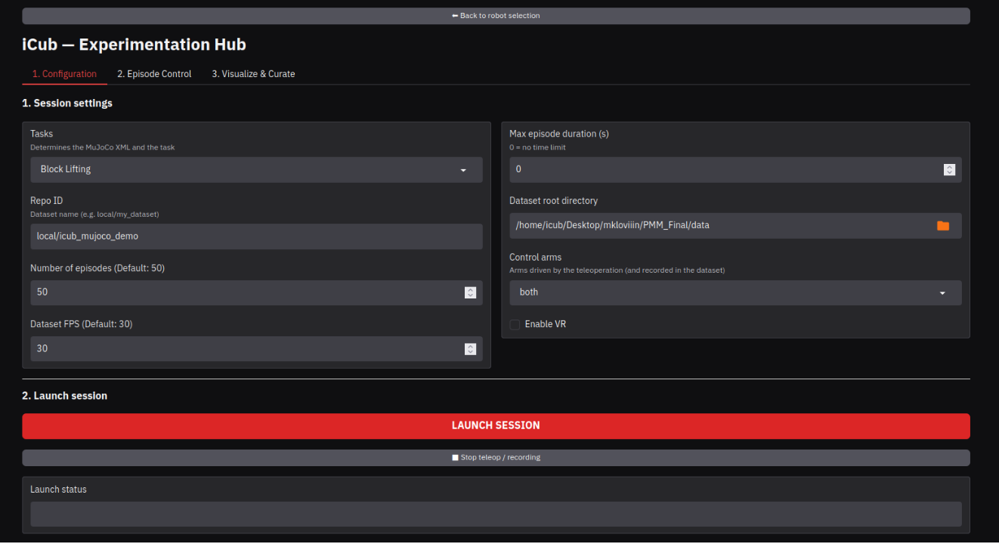
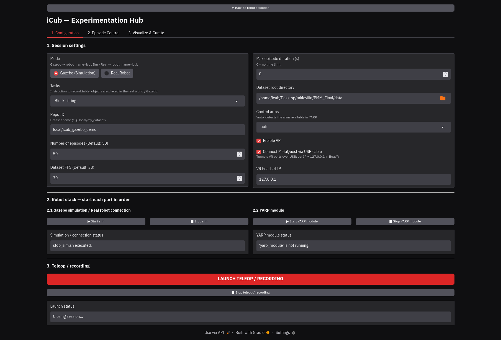
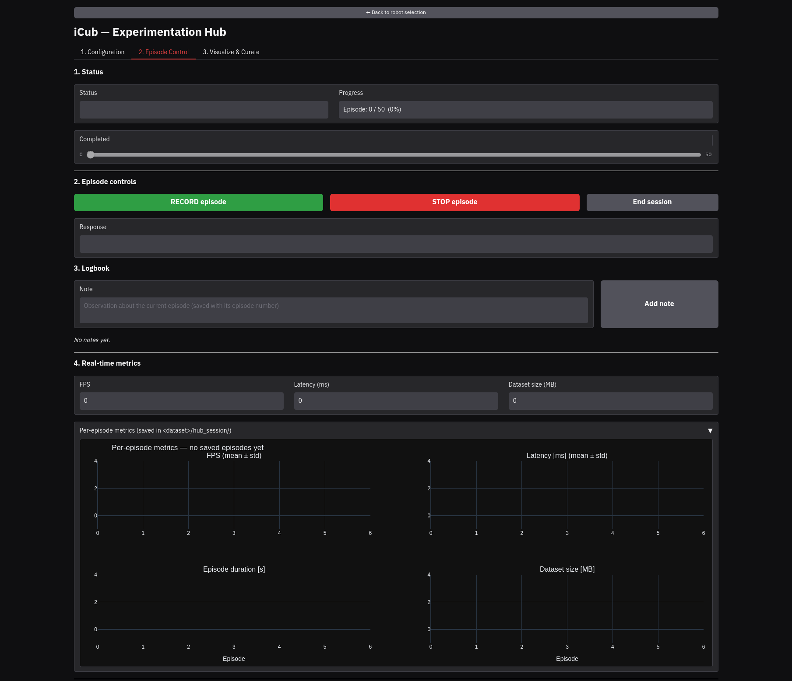
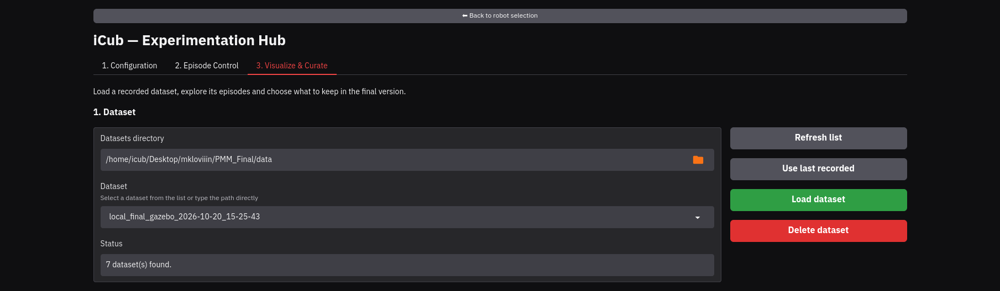
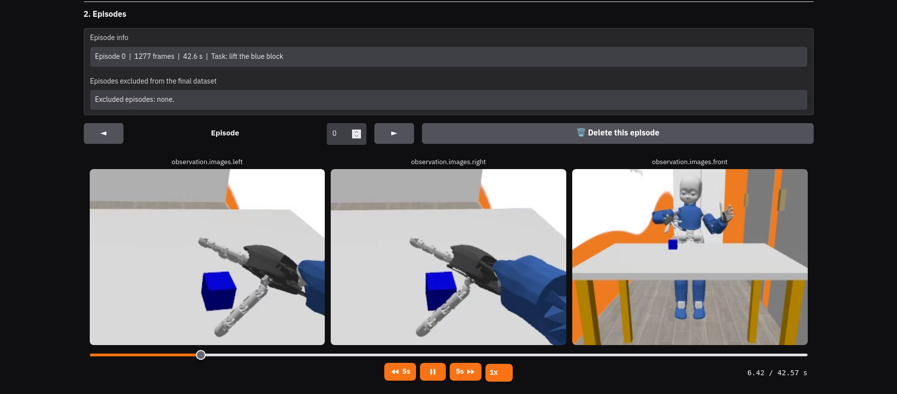
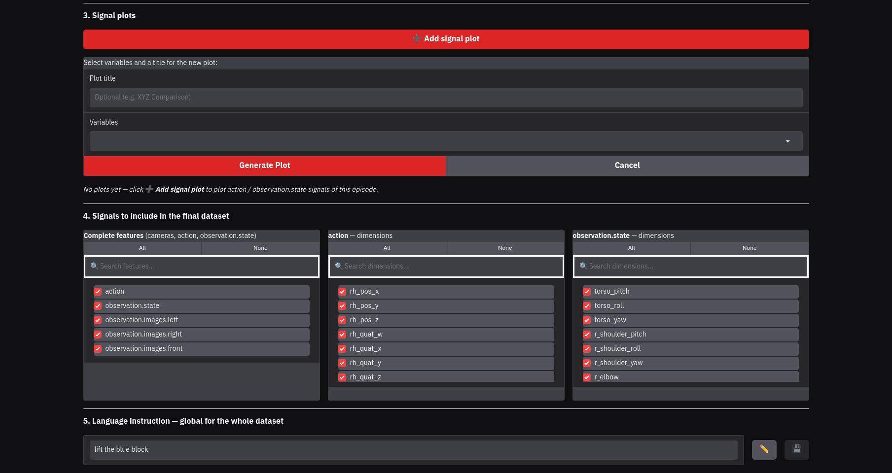
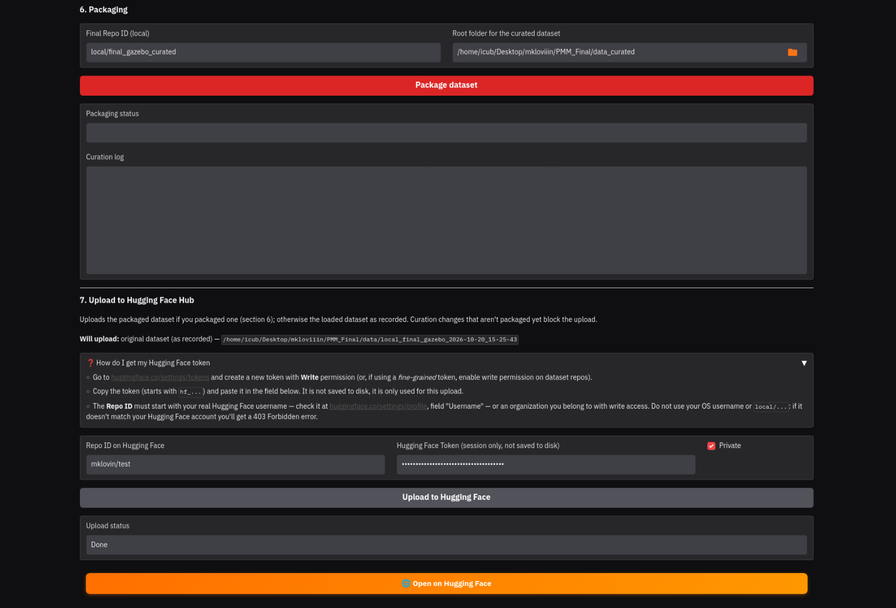

# User manual · Experimentation Hub

[← Back to README](../README.md)

This manual walks through a complete session, from choosing the platform to publishing the
dataset on Hugging Face. Installation and the VR headset setup are covered in the
[README](../README.md#installation).

- [Before you start](#before-you-start)
- [Welcome screen](#welcome-screen)
- [1. Configuration](#1-configuration)
- [2. Episode Control](#2-episode-control)
- [3. Visualize & Curate](#3-visualize--curate)
- [4. Train](#4-train)
- [5. Evaluate](#5-evaluate)
- [Where the data is saved](#where-the-data-is-saved)
- [Troubleshooting](#troubleshooting)

---

## Before you start

- The Hub is running and open at <http://localhost:7860>.
- The Meta Quest 2 has the BeaVR app installed and is connected over Wi-Fi or USB cable
  (see [VR headset](../README.md#vr-headset)).
- For the **real iCub**, the computer is on the robot's network and its YARP name server
  is running.

---

## Welcome screen

Choose the platform you are going to record with. **iCub Simulated MJ** runs the MuJoCo
simulation, and **iCub Real / Gazebo** works with both the Gazebo simulation and the
physical robot.



---

## 1. Configuration

### Session settings

Fill in the session parameters.

| Field | What it is |
|---|---|
| **Task** | Scene to record (Block Lifting, Pick-and-Place, …) |
| **Repo ID** | Dataset name, for example `local/icub_block_lifting` |
| **Number of episodes** | How many episodes the session will record |
| **FPS** | Recording frequency (30 by default) |
| **Max duration** | Maximum length of each episode in seconds (0 = no limit) |
| **Data folder** | Where the dataset is saved |
| **Control arms** | Which arms are teleoperated and recorded |
| **Controller (solver)** | Whole-body controller: **IK** (joint positions), **ID** (joint torques) or **ID + impedance** (compliant). In Gazebo / real it is applied when the YARP module starts |
| **VR connection** | USB cable, or the headset's IP for Wi-Fi |



### Robot stack (Gazebo / real only)

On the *iCub Real / Gazebo* platform, start the robot side in order before launching the
session.

1. **Start the simulation** (Gazebo mode) or **connect to the robot** (real mode). The
   status indicator turns green when it is ready.
2. **Start the YARP module**, which is the component that commands the robot.



### Launch the session

Press **LAUNCH SESSION** (MuJoCo) or **LAUNCH TELEOP / RECORDING** (Gazebo / real). The
launch status shows whether the session started correctly, and the Hub switches to
*Episode Control*.

---

## 2. Episode Control

### Recording with the VR headset

Put the headset on. You will see the robot's eyes and the front view, along with the
recording status.

| Control | Action |
|---|---|
| **A** | Start recording an episode |
| **B** | Stop recording and save the episode |
| **X** | Show or hide the help panel with these buttons (it also shows while the BeaVR app is paused) |
| **Y** | Reset the scene (repositions the objects) |
| **Index trigger** | Open and close the hand gradually |
| **Grip** (lower trigger, middle finger) | Clutch: hold it to reposition the controller without moving the robot; on release the hand continues from where it stopped |

A typical episode goes like this.

1. Press **Y** if you want the objects in a new position.
2. Press **A** and perform the task.
3. Press **B** when you finish, and the episode is saved.
4. Hold the **grip** whenever you need to reposition yourself.

### The Episode Control tab

The **RECORD episode**, **STOP episode** and **End session** buttons do the same as the
headset controls, which is useful when someone else is assisting the operator. The tab
also shows the session status, the progress (saved episodes out of the planned ones), live
metrics (FPS, latency, dataset size), per-episode metrics and the live log.

In the **Logbook** you can write notes about the current episode, for example if the
grasp failed or something unexpected happened. Each note is saved with the episode number.



When you have recorded all the episodes, press **End session**.

---

## 3. Visualize & Curate

### Choose the dataset

Select a dataset from the list and load it. From here you can also delete a dataset, which
sends it to the system trash after asking for confirmation.

> [!TIP]
> **Inspecting a dataset from Hugging Face:** Download it into `data/` (after `pixi run hf auth login` for private orgs) and click **Refresh list**:
> ```bash
> pixi run hf download CAMADA-UTFSM/BlockStacking_wb_icub --repo-type dataset --local-dir data/CAMADA-UTFSM_BlockStacking_wb_icub
> ```
> To physically replay episodes in MuJoCo and verify reproducibility, see [Replaying a dataset in MuJoCo](../README.md#replaying-a-dataset-in-mujoco-reproducibility-check).



### Review the episodes

Browse the episodes with the three cameras playing in sync. A single control bar moves all
of them, and a vertical line follows the video time on each plot. Clicking on a plot jumps
the videos to that instant. Mark the episodes that should be excluded from the final
dataset, for example failed attempts.



### Plots, signals and instruction

- **Signal plots.** Plot any dimension of `action` or `observation.state` over the video,
  and export the plots to HTML or PDF.
- **Signals to include.** Remove whole features or individual dimensions. The search box
  filters the list to find them quickly.
- **Language instruction.** Edit the task instruction for the whole dataset.



### Package and upload

1. **Package** to generate the curated dataset as a separate copy in `data_curated/`.
2. **Upload to Hugging Face Hub** with your user and token. The *Will upload* line shows
   whether the packaged or the original dataset will be uploaded. If there are curation
   changes that have not been packaged, the upload is blocked until you package them.



---

## 4. Train

Trains a **SmolVLA** policy on a recorded or curated dataset.

1. **Dataset.** Pick it from the list (`data/` by default; use the folder button for
   `data_curated/`). The summary shows episodes, dimensions, cameras and task.
2. **Run.** The run name, job name, W&B project and model repo are suggested from the dataset
   name, and you can edit them. The run is saved in `output/train/<run name>/`. Steps, batch
   size and checkpoint frequency start at SmolVLA's fine-tuning recipe (20000 steps, batch 64: ~3.2 h and ~19 GB on the RTX 5090).
3. **Logging and upload.** Turn on Weights & Biases and/or pushing the model to Hugging Face
   (private or public repo) and paste your keys. They are only used for this run and are not saved to disk. Leave the
   W&B key empty to use the account already logged in on the PC. The Hugging Face token and
   repo are checked before the training starts.
4. **Advanced settings** (folded) holds the rest of the hyperparameters: base model, chunk
   size, max state/action dims (set from the dataset), learning rate, workers, seed, etc.

Press **Start training**. The panel shows the step, loss, elapsed and remaining time, and
the full log is under *Training log*. Training takes almost all the GPU memory, so **while it
runs the rest of the Hub is locked**. Training keeps going if you close the Hub; when you open
it again, it goes straight to this tab.

**Stop training** asks for confirmation: the run ends and its folder (with any checkpoints
saved so far) is moved to the trash. A failed run is also moved to the trash. The log is kept
in `src/hub_dataset/logs/training/`. When it finishes, the panel shows the path of the model
(`output/train/<run name>/checkpoints/last/pretrained_model`) to use with `eval_policy.py`
(see [Downloading & evaluating a trained policy](../README.md#downloading--evaluating-a-trained-policy)
for local and Hugging Face checkpoints). When the Hub is opened again,
the tab starts from *Waiting to start* unless a training is still running.

---

## 5. Evaluate

Runs a trained policy in simulation for a number of episodes and measures its success rate
(`eval_policy.py`, the same success criteria as robosuite).

1. **Model.** Pick a training run from the list (`output/train/` by default) and its checkpoint
   (`last` = end of the training), or type a Hugging Face model ID. The summary shows the
   cameras, arms, chunk size and the dataset the model was trained on. The task and the
   instruction are set from that dataset.
2. **Task.** Choose the simulator and the task (scene). The controller is not chosen: it is the one the
   model's dataset was recorded with (`meta/control_config.json`), so the tab refuses models without it. The *task instruction*
   is the sentence given to the policy, the one it was trained with by default. Set the number
   of episodes and their maximum length (600 steps = 20 s). In MuJoCo, *Side of the task* sets
   where the object or the door handle is: alternating every episode (default), random, or
   always on one side (for a policy trained on one side only). *Show the simulation window*
   opens the MuJoCo viewer.
   - **Gazebo:** nothing has to be started in *Configuration*. The evaluation starts the
     simulation (if it is not running), waits for it, starts the YARP module with the model's arms
     and controller, and at the end closes what it started. The panel shows each step.
     The side of the task alternates as in MuJoCo (the door is fixed in Gazebo). The real robot is
     not available in this tab (the operator has to place the objects and judge the success).
3. **Advanced settings** (folded): action steps per inference (fewer = more closed-loop
   corrections), control rate, seed of the object positions and results folder.

Press **Start evaluation**. The panel shows the episode, the success rate so far (total, at the
end of the episode and per side), and *Results per episode* lists each episode. While it runs
**the rest of the Hub is locked**, and the evaluation keeps going if you close the Hub.

**Stop evaluation** asks for confirmation. Unlike training, the results are **not** deleted:
the finished episodes stay in the results folder and only the current one is dropped. Each
evaluation saves `summary.json`, `eval.log` and `videos/<camera>.mp4` (every episode in a row)
in `output/eval/<model>_<simulator>_<date>/`.

---

## Where the data is saved

| Location | Contents |
|---|---|
| `data/<repo_id>_<date>/` | Recorded (or downloaded Hugging Face) dataset in LeRobot format |
| `data/<repo_id>_<date>/hub_session/` | Per-episode metrics and logbook notes |
| `data_curated/` | Curated datasets |
| `output/train/<run name>/` | Policies trained from the Hub or `train_policy.py` (checkpoints) |
| `output/models/` | Models downloaded from Hugging Face |
| `output/eval/<name>_<backend>_<date>/` | Policy evaluation logs, `summary.json`, and `videos/*.mp4` |
| `src/hub_dataset/logs/` | Full log of each Hub run (training logs in `training/`, evaluation logs in `eval/`) |

The upload to Hugging Face includes the `data/`, `meta/` and `videos/` folders.

---

## Troubleshooting

| Problem | What to do |
|---|---|
| `adb devices` shows the headset as `unauthorized` | Put the headset on and accept *Allow USB debugging* |
| The headset does not show up in `adb devices` | Check the cable and the udev rule from the [README](../README.md#usb-cable-setup-one-time-only) |
| A VR port is busy when launching | The Hub frees the ports left by its own sessions. If another program holds them, the launch status says which one |
| The Gazebo or MuJoCo window does not open in Docker | Run `xhost +SI:localuser:$(id -un)` before `docker compose up` |
| The robot does not move in Gazebo / real | Check that the simulation (or the robot connection) and the YARP module are both green in *Robot stack* |
| The upload is blocked | There are curation changes without packaging. Package the dataset first |
| All tabs except *Train* are disabled | A training run is in progress. Wait for it to finish or stop it in *Train* |
| All tabs except *Evaluate* are disabled | An evaluation is in progress. Wait for it to finish or stop it in *Evaluate* |
| A Gazebo evaluation fails while starting | The panel and the *Evaluation log* say which step failed; the YARP module log is in `src/hub_dataset/logs/eval/<run>_yarp_module.log` and Gazebo's in `/tmp/tmux_output_pipe_gz_server` |
