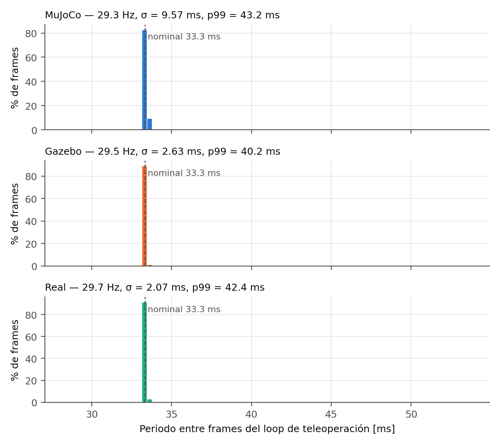
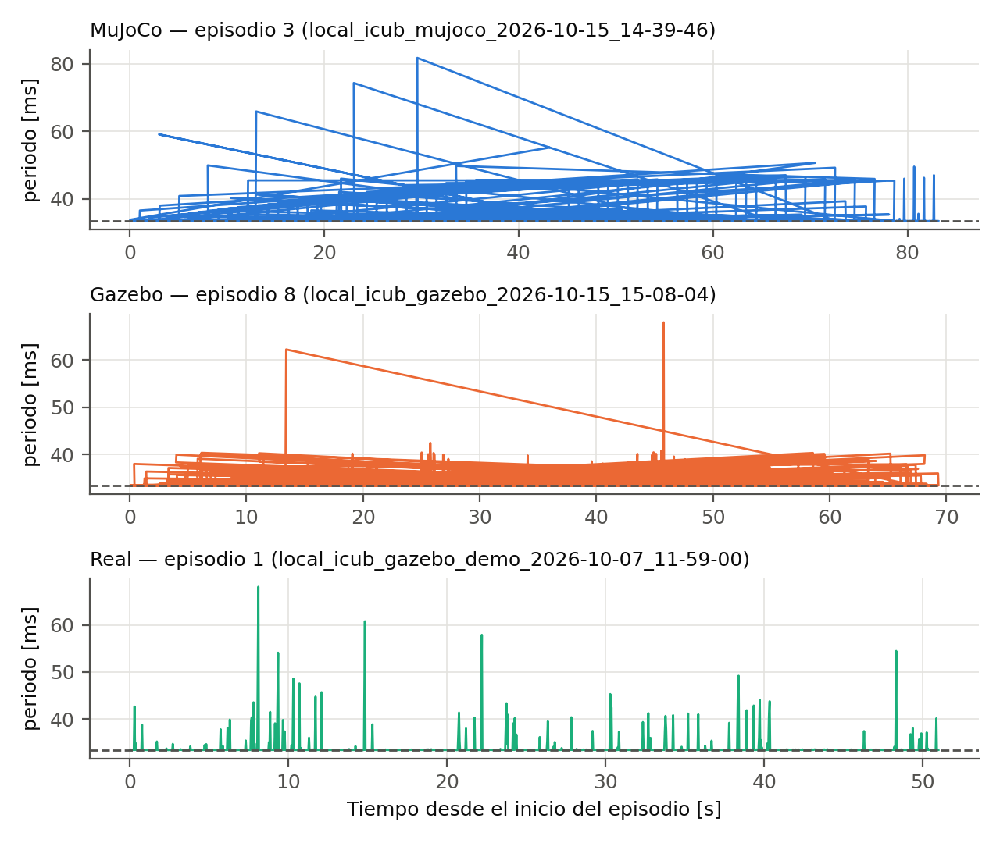
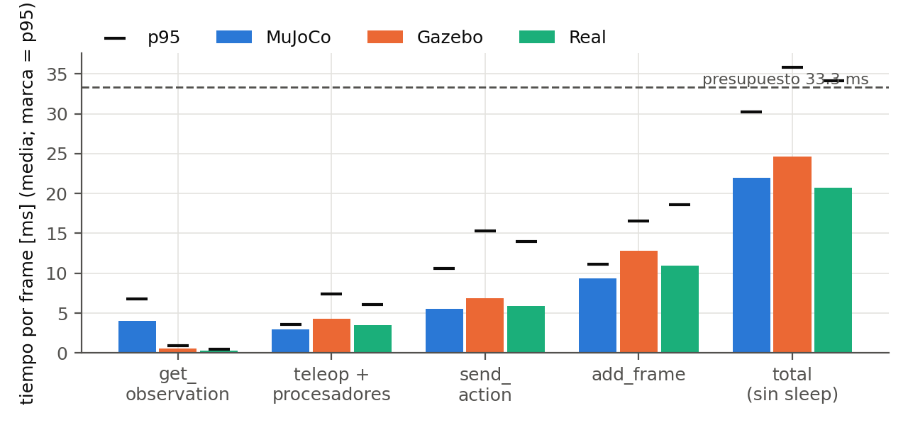
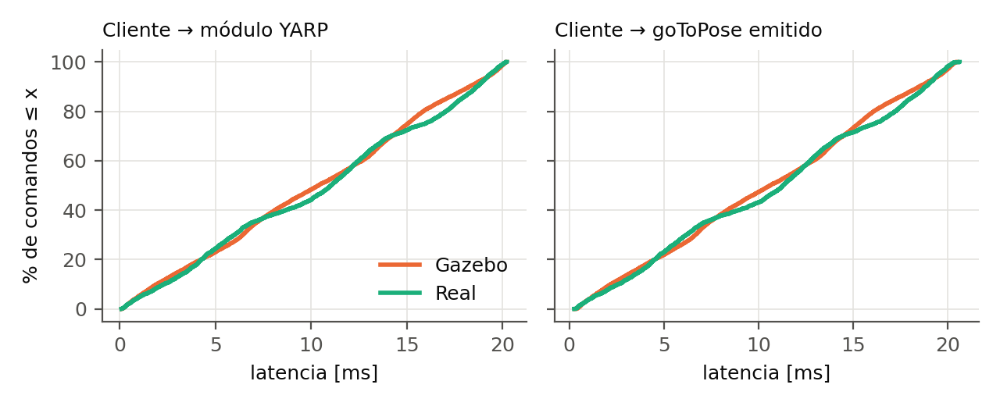
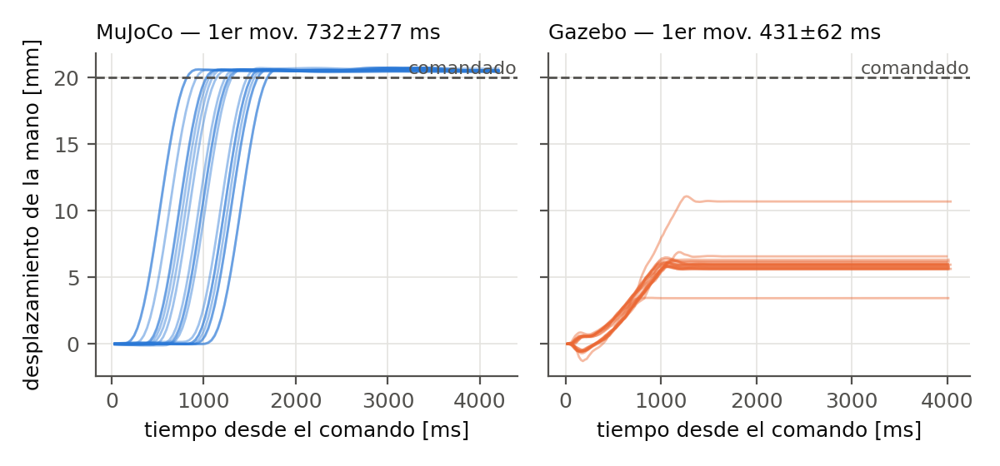
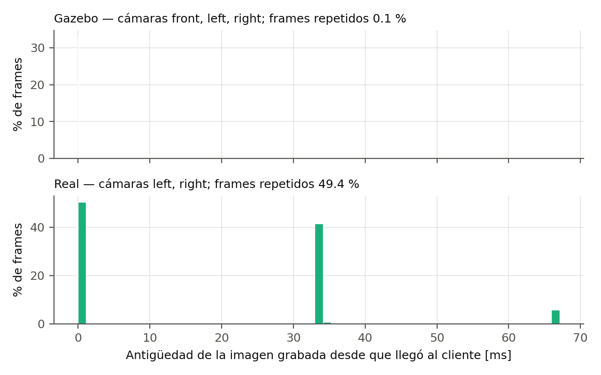
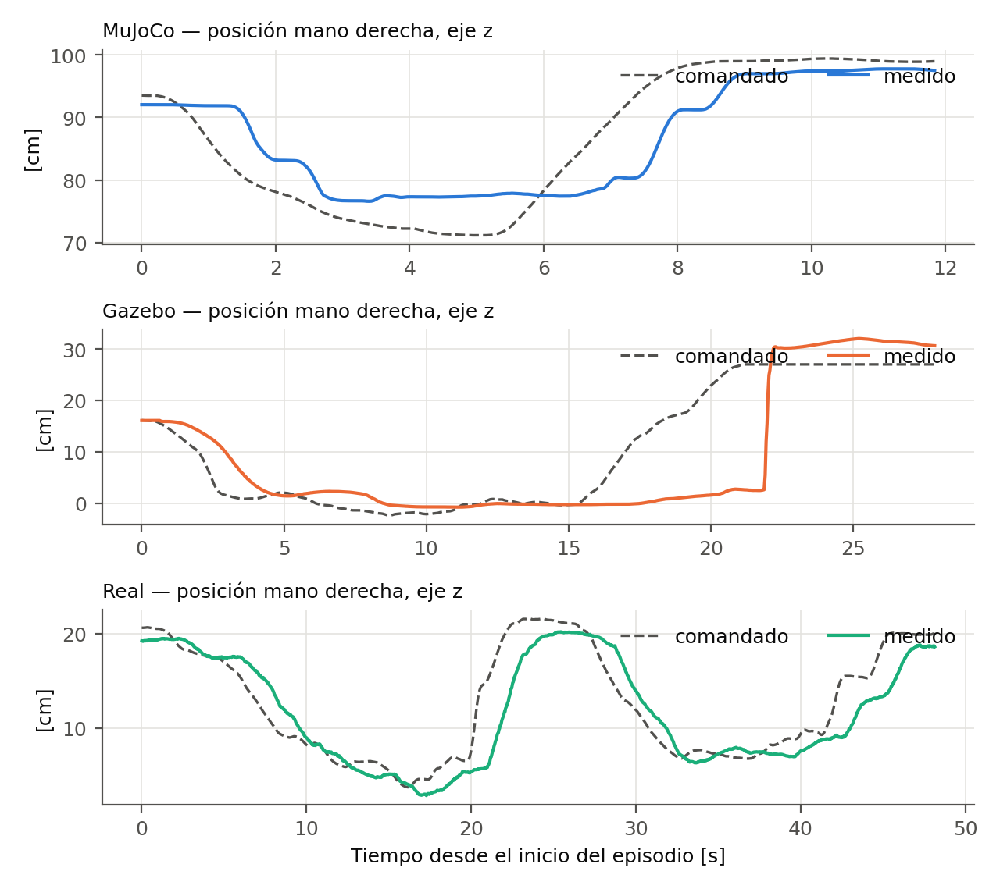

# Métricas de latencia, jitter y sincronización

## Loop de teleoperación/grabación

| Métrica | MuJoCo | Gazebo | Real |
|---|---|---|---|
| Sesiones / episodios / frames | 1 / 50 / 28339 | 1 / 25 / 13886 | 1 / 2 / 2941 |
| Frecuencia nominal [Hz] | 30 | 30 | 30 |
| Frecuencia efectiva [Hz] | 29.28 | 29.54 | 29.65 |
| Periodo media ± σ [ms] | 34.15 ± 9.57 | 33.85 ± 2.63 | 33.72 ± 2.06 |
| Periodo p50 / p95 / p99 [ms] | 33.4 / 35.2 / 43.2 | 33.4 / 36.1 / 40.2 | 33.4 / 34.2 / 42.4 |
| Periodo máx [ms] | 540.5 | 91.8 | 76.5 |
| Jitter σ [ms] | 9.57 | 2.63 | 2.07 |
| Jitter |T − T₀| medio [ms] | 0.82 | 0.52 | 0.39 |
| Frames perdidos (T > 1.5·T₀) | 0.61 % | 0.43 % | 0.34 % |
| Frames con trabajo > T₀ | 2.64 % | 10.07 % | 5.85 % |
| save_episode media [s] | 2.5 | 4.8 | 8.2 |

_T₀ = 1/fps. Periodo = tiempo entre inicios de frames consecutivos dentro de un episodio._

## Tiempo por etapa del loop (media / p95) [ms]

| Métrica | MuJoCo | Gazebo | Real |
|---|---|---|---|
| get_observation | 4.03 / 6.74 | 0.56 / 0.89 | 0.29 / 0.46 |
| teleop.get_action + procesadores | 3.00 / 3.55 | 4.31 / 7.36 | 3.53 / 6.09 |
| send_action | 5.57 / 10.62 | 6.90 / 15.33 | 5.92 / 13.99 |
| add_frame | 9.38 / 11.14 | 12.82 / 16.59 | 10.97 / 18.58 |
| Total (sin sleep) | 21.97 / 30.26 | 24.59 / 35.84 | 20.71 / 34.10 |

_En MuJoCo send_action incluye la física (IK + mj_step); en Gazebo/real solo escribe en YARP._

## Latencia de comando cliente → módulo YARP → controlador cartesiano [ms]

| Métrica | Gazebo | Real |
|---|---|---|
| Transporte media ± σ | 10.23 ± 5.81 | 10.48 ± 5.94 |
| Transporte p95 / p99 / máx | 19.4 / 20.0 / 20.2 | 19.3 / 20.0 / 20.2 |
| go_to_pose_async media ± σ | 0.25 ± 0.07 | 0.24 ± 0.10 |
| Total hasta goToPose media ± σ | 10.48 ± 5.81 | 10.71 ± 5.92 |
| Total p95 / p99 / máx | 19.7 / 20.3 / 20.5 | 19.5 / 20.2 / 20.7 |
| Comandos → goToPose enviado | 89.8 % | 93.0 % |
| Comandos en banda muerta (<1 cm/5°) | 10.2 % | 7.0 % |
| goToPose fallido | 0.00 % | 0.00 % |
| Comandos no procesados (mano der.) | 0.19 % | 0.07 % |
| RPC look_at (ida y vuelta) | 6.72 ± 5.34 | 5.74 ± 5.08 |

_Transporte = desde el write del cliente hasta que teleop_module_sm lo lee (incluye la espera a su siguiente ciclo, ≤ 20 ms). No procesados = reemplazados por uno más nuevo antes de ser leídos._

## Respuesta al escalón (comando → movimiento de la mano)

| Métrica [ms] | MuJoCo | Gazebo |
|---|---|---|
| Escalones | 20 × 2.0 cm | 20 × 2.0 cm |
| Primer movimiento (> 1 mm) | 732.2 ± 277.2 | 431.3 ± 61.7 |
| 10 % del valor final (≈ tiempo muerto) | 782.0 ± 277.6 | 332.6 ± 116.4 |
| 50 % del valor final | 992.1 ± 278.2 | 679.3 ± 66.2 |
| 90 % del valor final | 1201.2 ± 277.9 | 936.2 ± 84.3 |
| Asentamiento (±max(2 mm, 5 %)) | 1233.7 ± 278.0 | 795.3 ± 111.2 |
| Escalones asentados en la ventana | 100 % | 100 % |
| Sobrepaso [%] | 0.8 ± 0.4 | 3.6 ± 1.1 |
| Escalón logrado [%] | 102.5 ± 0.2 | 30.1 ± 6.1 |
| Error estacionario al target [mm] | 1.07 ± 0.03 | 13.97 ± 1.22 |
| Transporte 1er comando | — | 16.39 ± 7.90 |
| Periodo de muestreo de la pose | 35.0 ± 0.0 | 20.4 ± 0.2 |

_Media ± σ entre escalones (σ = jitter de la respuesta). Tiempos desde la escritura del comando; 10/50/90 % y sobrepaso respecto del desplazamiento final alcanzado. MuJoCo en tiempo simulado; Gazebo/real en tiempo de pared fechado con el envelope de la pose._

## Sincronización cámara / estado / acción

| Métrica | MuJoCo | Gazebo | Real |
|---|---|---|---|
| Antigüedad del estado articular [ms] | — | 10.49 ± 5.67 | 9.58 ± 5.79 |
| Espera del estado (lectura bloqueante) [ms] | — | 0.01 ± 0.12 | 0.02 ± 0.36 |
| Cámara front: frames nuevos / repetidos | — | 99.9 % / 0.1 % | — |
| Cámara front: frames perdidos en origen | — | 3.36 % | — |
| Cámara front: fps fuente / vistos por el loop | — | 30.2 / 29.3 | — |
| Cámara front: antigüedad desde llegada [ms] | — | 0.1 ± 0.5 | — |
| Cámara front: antigüedad desde captura [ms] | — | 16.1 ± 9.3 | — |
| Cámara front: desfase captura − estado [ms] | — | -5.2 ± 11.3 | — |
| Cámara left: frames nuevos / repetidos | — | 99.9 % / 0.1 % | 50.6 % / 49.4 % |
| Cámara left: frames perdidos en origen | — | 3.35 % | 0.00 % |
| Cámara left: fps fuente / vistos por el loop | — | 30.2 / 29.3 | 15.0 / 15.0 |
| Cámara left: antigüedad desde llegada [ms] | — | 0.0 ± 0.5 | 18.5 ± 20.2 |
| Cámara left: antigüedad desde captura [ms] | — | 16.8 ± 9.1 | reloj distinto |
| Cámara left: desfase captura − estado [ms] | — | -6.1 ± 10.6 | — |
| Cámara right: frames nuevos / repetidos | — | 99.9 % / 0.1 % | 50.6 % / 49.4 % |
| Cámara right: frames perdidos en origen | — | 3.35 % | 0.00 % |
| Cámara right: fps fuente / vistos por el loop | — | 30.2 / 29.3 | 15.0 / 15.0 |
| Cámara right: antigüedad desde llegada [ms] | — | 0.0 ± 0.5 | 18.5 ± 20.2 |
| Cámara right: antigüedad desde captura [ms] | — | 17.0 ± 9.1 | reloj distinto |
| Cámara right: desfase captura − estado [ms] | — | -6.2 ± 10.5 | — |
| Desfase estéreo |izq − der| media / máx [ms] | — | 2.9 / 33.0 | 2.6 / 67.2 |
| Desfase cámara − estado (t. simulado) [ms] | 0.000 | — | — |
| Render cámaras [ms] | 3.38 ± 2.20 | — | — |
| Física por frame [ms] | 3.50 ± 9.26 | — | — |
| Tiempo simulado / tiempo real | 1.035 | — | — |

_Repetido = el frame grabado reutiliza la imagen del frame anterior (no llegó una nueva). Antigüedad desde captura y desfases solo se calculan si la fuente comparte reloj con el PC._

## Seguimiento de la mano derecha durante la teleoperación

| Métrica | MuJoCo | Gazebo | Real |
|---|---|---|---|
| Error comandado − medido media ± σ [cm] | 4.52 ± 3.32 | 4.75 ± 3.90 | 3.19 ± 2.04 |
| Error p95 [cm] | 10.91 | 11.89 | 7.85 |
| Retardo por correlación cruzada mediana [ms] | 1136 | 1102 | 1252 |
| Episodios usados para el retardo | 49 | 24 | 2 |

_El error incluye el retardo de seguimiento. Retardo = desplazamiento que maximiza la correlación entre las velocidades comandada y medida (episodios con > 5 mm de movimiento)._

## Módulo YARP teleop_module_sm (desde los logs del Hub)

| Log | Robot | Hz (media / mín) | Peor ciclo p95 / máx [ms] | Cámaras fps izq / der | [SLOW] | IK fallidos | Mano−target mediana [cm] |
|---|---|---|---|---|---|---|---|
| hub_2026-10-05_17-20-44.txt | Real | 50.0 / 49.5 (obj. 50) | 52 / 291 | 18.7 / 18.7 | 49 | 0.00 % | 1.4 |
| hub_2026-10-07_11-35-09.txt | Real | 50.0 / 49.4 (obj. 50) | 26 / 230 | 15.1 / 15.1 | 20 | 0.00 % | 1.3 |
| hub_2026-10-07_16-34-23.txt | Gazebo | 50.0 / 48.0 (obj. 50) | 12 / 66 | 30.4 / 30.4 | 5 | 0.00 % | 0.7 |
| hub_2026-10-15_12-19-29.txt | Gazebo | 50.1 / 49.6 (obj. 50) | 27 / 53 | 31.6 / 31.6 | 2 | 0.00 % | 0.5 |
| hub_2026-10-15_15-07-05.txt | Gazebo | 50.1 / 49.7 (obj. 50) | 18 / 57 | 30.5 / 30.5 | 1 | 0.00 % | 2.7 |

_Agregados cada 5 s que imprime el propio módulo; complementan las métricas por frame._

## Figuras

